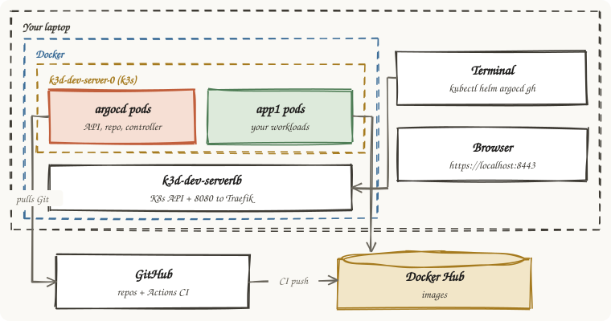

# 00 · Lab Setup: a local Argo CD playground

> Read once, then use [section 5](#5-session-routine-every-lab) at the start and end of every lab session.
>
> **Cost:** $0. Everything runs on your laptop; GitHub and Docker Hub free tiers cover the rest.

---

## TL;DR

1. **k3d** runs a real k3s Kubernetes cluster inside Docker containers. Argo CD can't tell it apart from a cloud cluster.
2. One cluster named **`dev`**, Argo CD installed with **Helm** into namespace `argocd`, release name **`my-argo-cd`**.
3. Reach Argo CD with a **port-forward to `localhost:8443`**. Port 8080 is taken by k3d's built-in Traefik load balancer.
4. `k3d cluster stop dev` / `start dev` pause and resume everything (Argo CD included) between sessions.
5. Images are built by **GitHub Actions** and pushed to **Docker Hub**. A local `docker build` is invisible to the cluster.

---

## 1. What runs where

<picture>
  <source media="(prefers-color-scheme: dark)" srcset="../images/lab-environment-dark.svg">
  
</picture>

*What runs where: the k3d node is a container inside Docker; Argo CD pulls from GitHub, pods pull images from Docker Hub.*

- **Docker images and cluster images are separate stores.** A `docker build` on the laptop isn't visible to pods unless you push it to a registry (the flow used here) or run `k3d image import  -c dev`.
- Git **webhooks can't reach your laptop**, so Argo CD notices Git changes by polling (about every 3 minutes) or when you click **REFRESH**.

### Tested environment

| Item | Used here | Also works |
|---|---|---|
| OS / shell | Windows 11, Git Bash-style terminal (paths like `/c/Users/...`) | Linux, macOS, WSL2 |
| Container runtime | Docker | Any Docker-compatible engine k3d supports |
| Cluster | k3d (k3s) | kind, minikube |
| Argo CD | Helm chart `argo/argo-cd` **9.1.9** (Argo CD v3.2) | Newer charts, check release notes |
| `argocd` CLI | v3.2.2 | Match the server's minor version |
| Git credentials | Git Credential Manager (browser login, token stored by the OS) | SSH keys |

---

## 2. One-time setup

### 2.1 Tools

Install and check: `docker`, `kubectl`, `k3d`, `helm`, `git`, `gh` (GitHub CLI), `argocd`.

```bash
docker version
kubectl version --client
k3d version
helm version
gh --version
argocd version --client
```

**`argocd` CLI on Windows (no admin rights needed):** download `argocd-windows-amd64.exe` from the Argo CD GitHub releases page, save it as `~/bin/argocd.exe`, make sure `~/bin` is on your `PATH`, then run `hash -r` and `argocd version --client`.

### 2.2 Git identity and credentials

```bash
git config --global user.name  "<YOUR NAME>"
git config --global user.email "<YOUR EMAIL>"
git config --global init.defaultBranch main
git config --show-origin --get-all credential.helper   # Git for Windows: "manager" at system level = GCM is ready
```

- **Never embed a token in a remote URL** (`https://<token>@github.com/...`): it's stored in plain text in `.git/config`. GCM opens a browser login once and keeps the token in the OS credential store.
- Prompts that ask for secrets must run **on their own line**. A multi-line paste can be swallowed as the password.

### 2.3 The cluster

```bash
k3d cluster list                      # already have one? reuse it and use its name wherever these notes say "dev"
k3d cluster create dev --port "8080:80@loadbalancer" --wait
kubectl get nodes                     # k3d-dev-server-0   Ready
kubectl config current-context        # k3d-dev
```

- `--port "8080:80@loadbalancer"` publishes the bundled **Traefik** ingress on host port 8080. That's why Argo CD uses **8443** in these notes.
- One server and no agents is enough for every lab up to lecture 09.

### 2.4 Install Argo CD

```bash
helm repo add argo https://argoproj.github.io/argo-helm
helm repo update
kubectl create ns argocd
helm install my-argo-cd argo/argo-cd --version 9.1.9 -n argocd --timeout 15m
kubectl get pods -n argocd -w          # Ctrl+C when all Running
```

- **Pin the chart version** (`--version`). An unpinned install changes under you.
- `--timeout 15m`: the first install pulls many images; the default 5 minutes can time out on a laptop.
- Low on RAM? Add `--set dex.enabled=false --set notifications.enabled=false`. Dex returns with SSO, notifications with alerting.

### 2.5 First login

```bash
kubectl port-forward svc/my-argo-cd-argocd-server -n argocd 8443:443      # own terminal, leave running
```
```bash
kubectl -n argocd get secret argocd-initial-admin-secret -o jsonpath="{.data.password}" | base64 -d; echo
```
```bash
argocd login localhost:8443 --insecure --username admin                   # run alone: it prompts
```

UI: **https://localhost:8443** (accept the self-signed certificate). Change the admin password, then delete `argocd-initial-admin-secret`.

---

## 3. Lab conventions used in every lecture

| Convention | Meaning |
|---|---|
| `NOTES` | The root of this repo. Set it once per terminal: `cd <this repo> && export NOTES=$PWD`. Lab commands copy files from `$NOTES/labs/...`. |
| `~/gitops/` | Where your own lab repos live (each one pushed to its own GitHub repo) |
| `<GITHUB_USER>` / `<DOCKERHUB_USER>` | Placeholders in lab files. Replace them after copying (see the repo README). |
| Port 8443 | Argo CD UI and CLI |
| Port 8081 | App port-forwards (`kubectl port-forward svc/... 8081:80`) |
| You run the commands | Every lab step says what it does and what to expect before you run it |

---

## 4. Local vs cloud

| Topic | Where | Why |
|---|---|---|
| 01 GitOps | Laptop, Git only | Theory + Git practice |
| 02–09 Install, Applications, private repos, projects, hooks, waves, Helm, app-of-apps | Local k3d + GitHub + Docker Hub | Argo CD behaves the same on any conformant cluster |
| 10 ApplicationSets | Local hub + extra k3d "spoke" clusters | Cluster generators need several clusters; k3d makes them in seconds |
| Secrets (External Secrets) | Local mechanics, then AWS | IAM-based access to AWS Secrets Manager is the real lesson |
| SSO / RBAC, image promotion, rollouts, notifications | Local | OAuth callbacks go to your browser; webhooks are outbound |
| Capstone (EKS, RDS, ALB, IRSA/Pod Identity) | AWS, created and destroyed per session | Things a laptop can't simulate: IAM, managed databases, load balancers, multi-AZ |

**Not learnable locally:** pod IAM roles (IRSA / Pod Identity), managed databases owned by Terraform, ALB + ACM + Route 53, private subnets and NAT, Git webhooks into Argo CD.

---

## 5. Session routine (every lab)

### Start
```bash
k3d cluster start dev
kubectl get pods -n argocd                       # all Running (allow ~1 min after start)
kubectl port-forward svc/my-argo-cd-argocd-server -n argocd 8443:443      # own terminal
```
```bash
argocd login localhost:8443 --insecure --username admin                   # only if the CLI session expired
kubectl get app -n argocd
```

### Stop
```bash
# Ctrl+C every port-forward and watch, then:
k3d cluster stop dev                             # frees ~1.5–2 GB RAM; everything resumes on start
```
Full reset (rarely): `k3d cluster delete dev`, then sections 2.3–2.5.

---

## 6. Gotchas

| Symptom | Cause | Fix |
|---|---|---|
| `argocd login localhost:8080` → `rpc error: code = Unimplemented ... 404 ... text/plain` | Port 8080 is k3d's Traefik, not Argo CD | Port-forward Argo CD to **8443** and log in there |
| `argocd: command not found` | CLI not installed or not on `PATH` | Section 2.1, then `hash -r` |
| `Invalid username or password` right after pasting several lines | The paste was read as the password | Run prompting commands alone |
| Forgot the admin password | – | `kubectl -n argocd patch secret argocd-secret -p '{"data":{"admin.password":null,"admin.passwordMtime":null}}'`, delete `argocd-initial-admin-secret`, `kubectl -n argocd rollout restart deployment my-argo-cd-argocd-server`, wait, read the new initial secret |
| Pods `Pending` (insufficient memory) | Laptop RAM | Lean install (2.4), stop other clusters, close heavy apps |
| `ImagePullBackOff` on an image you built locally | Docker images ≠ cluster images | Push through CI to a registry, or `k3d image import  -c dev` |
| Argo CD ignores your push for ~3 minutes | No webhooks reach the laptop | Click **REFRESH**, or `argocd app get <app> --refresh` |
| Helm install times out | Slow first image pulls | `--timeout 15m`; check `kubectl get pods -n argocd` |
| `kubectl get jobs,pods -w` → `you may only specify a single resource type` | `-w` watches one type | `kubectl get pods -n <ns> -w` |
