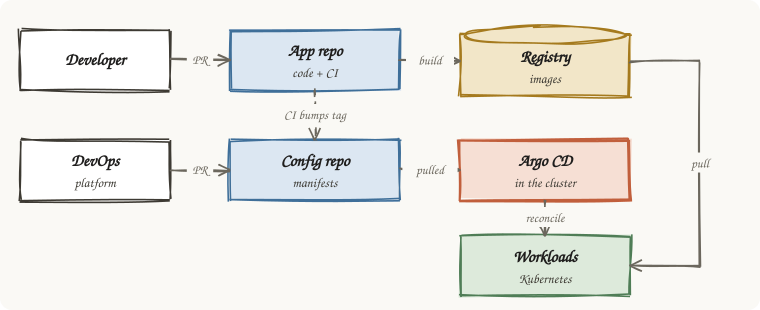
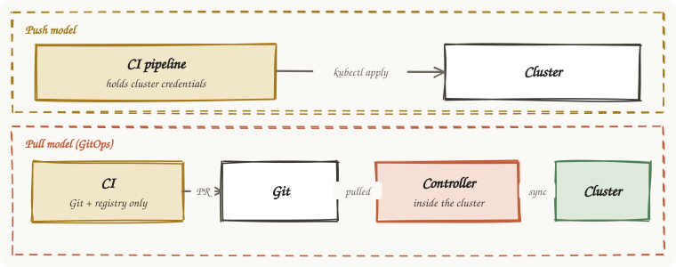

# 01 · What is GitOps?

> **Lab needs:** no cluster. Theory plus a local Git lab on your laptop.
>
> **Time:** ~1 h reading + 45 min lab + 20 min revision

---

## TL;DR (read this before every revision)

1. **GitOps is an operating model, not a tool.** Argo CD and Flux are tools that *implement* it.
2. **Desired state** lives in Git. **Current (live) state** is what runs in the cluster. Any difference between them is **drift**.
3. **OpenGitOps (CNCF) principles:** **Declarative**, **Versioned and immutable**, **Pulled automatically**, **Continuously reconciled**.
4. GitOps fixes **two separate problems**:
   - (a) infra and config files were *not version-controlled*;
   - (b) even when they were, *nothing kept checking* that the cluster still matched Git.
5. **Two repos, two pipelines:**
   - **App repo**: CI builds, tests and publishes an image. It **never deploys**.
   - **Config repo**: declares how and where that image runs. A **GitOps controller pulls** it into the cluster.
6. **The handoff:** after pushing the image, CI acts as a *Git user*. It opens a PR on the config repo that bumps the image tag or digest. The merge is the deploy intent.
7. **Push vs pull:**
   - **Push:** CI runs `kubectl` or `helm` and holds cluster credentials.
   - **Pull:** a controller inside the cluster pulls from Git. CI gets **no cluster access**.
8. **Rollback** = `git revert`. The controller sees the revert and converges back.
9. GitOps is most mature on **Kubernetes**, because Kubernetes itself is built on reconciliation loops.

---

## 1. Why GitOps exists

### How things looked before

| Layer | Managed in Git with discipline? | Reality |
|---|---|---|
| **Application code** | ✅ Yes | Feature branches → PR → CI tests → protected `main`/env branches |
| **Infrastructure** (Terraform, CloudFormation) | ⚠️ Sometimes | Templates sat on someone's laptop or jump host and were applied by hand |
| **Configuration** (K8s manifests, Helm, Kustomize, Ansible, Chef, Puppet) | ❌ Often not | Edited in place, applied imperatively, scattered across DevOps workstations |

> Sooner or later an unversioned change lands on your desk, and "someone who left the company did that" is never an acceptable answer. Version-control your Terraform and manifests from day one.

**Branching refresher:**

- **Trunk-based:** only `main` plus short-lived feature branches. `main` is the single source of truth.
- **GitFlow:** environment branches (`dev`, `stage`, `prod`) plus feature branches.
- In production, `main` and the environment branches are **protected**. You push to a feature branch and merge through a PR.

### The six problems without a unified model

| # | Problem | Concrete example |
|---|---|---|
| 1 | **No single source of truth** | Git, the cluster and an engineer's terminal all show different `replicas` values. Which one is right? |
| 2 | **Desired vs current state mismatch** | Git says `replicas: 5`. Someone runs `kubectl scale --replicas=3`. **Nobody notices.** |
| 3 | **Manual, imperative changes** | Even CI-run `kubectl apply` is a *one-time* command. There's no PR review and no ongoing enforcement. |
| 4 | **Weak audit and rollback** | "Which commit produced this deployment?" Unknown. Rollback means guessing whose copy of the YAML to trust. |
| 5 | **Environment drift** | dev, stage and prod start identical, then hotfixes pile up and nobody knows the known-good state. |
| 6 | **Security risk** | Jenkins needs deploy *and delete* rights on your EKS cluster. A leaked credential or a wrongly triggered pipeline can do a lot of damage. |

> 🔑 **Key point:** there are really **two core challenges**.
> **Challenge 1:** infra and config were not version-controlled.
> **Challenge 2:** even when they were, **no controller compared desired state with current state**.
> The first is fixed by discipline (Git and PRs). The second needs **software**: a GitOps controller.

---

## 2. What GitOps is (CNCF definition)

> **GitOps (CNCF OpenGitOps):** an operating model where the **desired state** of applications and infrastructure is **declared in Git**, and **software agents continuously reconcile** the running system to match that state.

Like DevOps or DevSecOps, it's a **methodology or culture**. You can't buy it or install it.

### The four OpenGitOps principles ([opengitops.dev](https://opengitops.dev))

| Principle | Meaning | Which problem it solves |
|---|---|---|
| **Declarative** | You describe *what* you want (`replicas: 5`), not *how* to get there (`kubectl scale`) | Imperative one-off changes |
| **Versioned and immutable** | Desired state is stored in Git with full, unchangeable history | No source of truth, weak audit |
| **Pulled automatically** | Agents *pull* desired state from Git; nobody pushes into the environment | Security (CI has no cluster credentials) |
| **Continuously reconciled** | Agents keep comparing live state with Git and correct differences | Drift (Challenge 2) |

> ⚠️ Under the CNCF definition, **continuous reconciliation is mandatory**. "We deploy from Git with a pipeline" is *not* GitOps on its own.

**Reconcile** = the agent makes sure what is running in the cluster *right now* matches what Git says, and keeps doing that.

### Benefits

| Benefit | How you see it in practice |
|---|---|
| **Single source of truth** | Git answers "what should be running?" without ambiguity |
| **Drift detection and correction** | Manual `kubectl edit` gets detected and reverted |
| **Improved security** | No cluster credentials in Jenkins, GitHub Actions or GitLab. Access is governed by Git permissions and PR reviews |
| **Audit and rollback** | Every change is a commit or PR. Rollback is `git revert` |
| **Clear ownership** | Developers own the app repo; DevOps or platform owns the config repo |
| **Consistency at scale** | The same model across teams, environments and clusters |

---

## 3. Repository structure and ownership

The best practice (recommended, not mandatory) is **two repos**, each with **its own pipeline**.

| | **Application repo** (`app1`) | **Application config repo** (`app1-config`) |
|---|---|---|
| **Purpose** | Build, test and package code into a **versioned, deployable artifact** | Define **how and where** approved artifacts run in each environment |
| **Contains** | Source code, unit and integration tests, **Dockerfile**, CI definitions (`Jenkinsfile`, `.github/workflows/*.yml`, `.gitlab-ci.yml`, `buildspec.yml`), build and test scripts | **K8s manifests, Helm charts, Kustomize bases and overlays**, Terraform or CloudFormation, Ansible, Chef, Puppet |
| **Pipeline does** | Build → test → SAST/DAST, SBOM, image scan (SonarQube, Trivy) → **publish image** | Validate config (lint, policy, ephemeral deploy). **No build.** |
| **Pipeline never** | **Deploys** anything | **Builds** code |
| **Primary owner** | Application or dev team (DevOps is secondary: CI files, guardrails) | DevOps or platform team (devs propose changes via PR) |

> 📌 Security scans and image push steps live in the **app repo** pipeline. They are *build-time* concerns, not runtime desired state.

---

## 4. End-to-end GitOps workflow

<picture>
  <source media="(prefers-color-scheme: dark)" srcset="../images/gitops-flow-dark.svg">
  
</picture>

*The handoff: CI publishes the image and opens a PR on the config repo; Argo CD pulls the config repo and reconciles.*

```
 APP REPO PIPELINE (build-time)                         CONFIG REPO PIPELINE (runtime)
 ─────────────────────────────                          ────────────────────────────────
 1. Dev changes code                                    1. Change arrives:
 2. Push to feature branch                                 a) automated PR from CI (image bump), or
 3. PR → webhook → CI (Jenkins/GHA):                       b) DevOps change (limits, NetworkPolicy, ConfigMap…)
      build, test, SAST/DAST, SBOM, scan                2. Feature branch → PR
 4. CI green (+ review) → merge to main/env branch      3. Validate: deploy to EPHEMERAL env (temp namespace),
      "artifact approved, NOT deployed"                       probes green, smoke test → env torn down
 5. Publish image to registry (ECR, Docker Hub)         4. Merge = approved deployment intent
      "no cluster touched"                              5. GitOps controller (Argo CD / Flux) PULLS
                │                                          Git ──▶ Cluster, and keeps reconciling
                │      THE HANDOFF                         (drift → auto-revert to Git)
                └──▶ CI clones config repo, bumps image ──▶ opens PR (starts step 1a)
```

### The handoff: the most important boundary

After publishing the image, CI acts **again**, but as a **Git user, not a deployer**:

1. It clones the config repo.
2. It creates a short-lived branch and updates the image reference (in the YAML, the Helm `values.yaml` or the Kustomize overlay).
3. It opens a PR → validation → merge.
4. The controller detects the new commit and pulls it into the cluster.

> **This is exactly where build ends, Git declares desired state, and GitOps begins.**

A DevOps engineer doing this by hand follows the same steps; CI simply automates what a human would do.

### Two ways the config repo changes

| Trigger | What changes | Who |
|---|---|---|
| **Developer-driven** (via CI) | Typically **only the image tag or digest**. Everything about the new app version is inside the image. | CI bot, as a Git user |
| **DevOps-driven** | Requests and limits, Namespaces, NetworkPolicies, ConfigMaps, new Deployments… **never** the app image version | DevOps engineer |

### Tag vs digest

| | Image **tag** (`app1:v1.0.0`) | Image **digest** (`app1@sha256:9f86d0…`) |
|---|---|---|
| Mutable? | **Yes.** Someone can re-push a different image under the same tag. | **No.** Change one bit and the digest changes. |
| Where it's used | Dev and lower environments (and most of these labs) | **Production** |
| Risk | Human error, silent changes | None of that kind; the digest pins exactly what you tested |

### Why GitOps fits Kubernetes best

- Kubernetes is **already built on reconciliation**. The Deployment and ReplicaSet controllers keep 5 replicas running if you asked for 5.
- A GitOps controller just adds one more loop: **Git → cluster**.
- **Terraform:** `terraform plan` *can* show drift, but only when someone runs it. No controller keeps checking.
- **Ansible, Chef, Puppet:** you should version them, but there's no mature continuous GitOps reconciler for them.
- **Crossplane** manages cloud resources through Kubernetes CRDs. See the clarification in section 7 on whether it counts as GitOps.

---

## 5. Push vs pull deployment

<picture>
  <source media="(prefers-color-scheme: dark)" srcset="../images/push-vs-pull-dark.svg">
  
</picture>

*Push: CI holds cluster credentials. Pull: CI only touches Git; a controller in the cluster pulls and reconciles.*

| Aspect | **Push** (traditional CI/CD) | **Pull** (GitOps) |
|---|---|---|
| Who deploys | CI/CD pipeline runs `kubectl apply`, `helm upgrade`… | A controller **in or next to the cluster** |
| Control flow | CI → Environment | **Git → Environment** |
| Execution | **Event-driven, one-time.** The pipeline runs, finishes and forgets. | **Continuous reconciliation** |
| Credentials | CI holds cluster or cloud credentials (large blast radius) | **No external push access.** CI only needs Git access. |
| Drift | Undetected until someone re-runs the pipeline | Detected **and** corrected automatically |
| Failure recovery | Fix Git, then re-run the pipeline or redeploy by hand | `git revert` → self-heals to the last known good state |
| Required for CNCF GitOps? | No | **Yes** |

> Nobody can walk into the cluster and make a change that isn't in Git, and if someone does, it gets reverted automatically.

---

## 6. Where Argo CD fits

Argo CD (and Flux) is the **software agent** from the definition. It:

- continuously **watches Git** for desired state,
- **compares** Git with the live cluster,
- **reconciles drift**,
- enforces **Git → Cluster** control flow.

**Argo CD is not GitOps. It's a controller that implements GitOps on Kubernetes.** Lecture 02 covers how it works inside.

---

## 7. Production reality and pitfalls

These are common simplifications, and things real teams do differently. Knowing them is what separates "read about GitOps" from "can run it in production".

### Common claims, with production nuance

| Common claim | Nuance for production |
|---|---|
| "Crossplane is not true GitOps because the CRDs are the source of truth, not Git" | That's only true if you `kubectl apply` the CRDs by hand. **If the Crossplane claims are stored in Git and synced by Argo CD, all four principles are met.** Git → Argo CD → CRD → Crossplane → AWS, and both loops reconcile continuously. This is a well-known pattern for doing infrastructure with GitOps. |
| "Config repo contains Terraform too" | In many companies **Terraform lives in its own infra repo**, run by its own pipeline (Atlantis, Terraform Cloud, GitHub Actions with `plan` on PR and `apply` on merge). Same Git discipline, but **not continuously reconciled**. Scheduled drift-detection runs (`terraform plan -detailed-exitcode` on a cron) are the usual workaround. This is the model we use for RDS in the capstone. |
| "`git revert` and you're back" | True for **stateless** config. It is **not** true for data. Reverting an image doesn't undo a database schema migration or restore deleted rows. Stateful rollbacks need backward-compatible migrations and backups (see lectures 06 and 07, and the capstone). |
| "DevOps is the sole owner of the config repo 99.99% of the time" | With platform teams, devs often own `apps/<team>/` folders while platform owns `platform/`, enforced with **CODEOWNERS** and branch protection. Ownership is per path, not per repo. |
| Ephemeral environment per PR | Real setups use the **ApplicationSet Pull Request generator** to create a temporary Argo CD app per PR (you'll see generators in lecture 10). Many teams skip this and rely on a `dev` environment instead. |
| Auto-revert of manual changes | That needs **auto-sync and self-heal** turned on (lecture 04). With manual sync, Argo CD only *shows* drift (`OutOfSync`) and doesn't fix it. |

### What changes in real companies

- **Break-glass hotfixes:** in an incident someone will want to `kubectl edit`. The GitOps-correct process is a fast-tracked PR. If you *must* patch live, disable self-heal for that app first, otherwise Argo CD reverts your fix within minutes. Then commit the fix to Git immediately.
- **Secrets are never in Git as plain text.** GitOps says "everything in Git", so you store a *reference* (an `ExternalSecret`) and keep the value in AWS Secrets Manager. That's module 11.
- **CI still needs *some* credentials:** registry push and Git write (a bot token or GitHub App). It just doesn't need cluster credentials. Keep the bot's Git permissions narrow (it can open PRs but can't merge to `prod`).
- **Image bump tooling:** the "CI clones the config repo and edits the YAML" step is usually done with `kustomize edit set image`, `yq`, or **Argo CD Image Updater**. That's module 14.

### Stateless vs stateful, through the GitOps lens

| | Stateless (e.g. `ui`) | Stateful (e.g. `orders` + PostgreSQL) |
|---|---|---|
| Can Git fully recreate it? | ✅ Yes: delete the cluster, re-point Argo CD, done | ❌ Config yes, **data no** |
| Who owns it | Argo CD | The DB itself → **Terraform (RDS)**. Argo CD owns only the app plus the `ExternalSecret` pointing at the DB. |
| Rollback | `git revert` | `git revert` the app, but schema and data need a separate plan (backward-compatible migrations, snapshots) |

### Common mistakes

1. Calling a Jenkins `kubectl apply` pipeline "GitOps". It's push-based with no reconciliation.
2. Putting Dockerfiles or CI YAML in the config repo, or manifests in the app repo pipeline's deploy step.
3. Using `:latest` or mutable tags in prod, so you can't tell what's running.
4. Letting humans keep `cluster-admin` "just in case". That defeats the security model.
5. Thinking Argo CD replaces CI. It doesn't: CI still builds, tests and scans.

---

## 8. Hands-on lab (local, no cluster)

**Goal:** feel "Git as the source of truth" and practise the `git revert` rollback that Argo CD will later enforce in the cluster.
**Where:** any terminal with Git (Git Bash, Linux, macOS). No cluster needed.

### Lab 1A: model a config repo and a PR-style change

```bash
# Create a throwaway config repo outside this notes repo
mkdir -p ~/gitops-lab1/app1-config && cd ~/gitops-lab1/app1-config
git init -b main
```
*What it does:* creates a fresh repo with `main` as the default branch. This plays the role of your **app config repo**.

```bash
cat > deploy.yaml <<'EOF'
apiVersion: apps/v1
kind: Deployment
metadata:
  name: app1
spec:
  replicas: 5
  selector:
    matchLabels: { app: app1 }
  template:
    metadata:
      labels: { app: app1 }
    spec:
      containers:
        - name: app1
          image: example/app1:v1.0.0
EOF
git add deploy.yaml
git commit -m "app1: initial desired state (5 replicas, v1.0.0)"
```
*Why:* this commit **is** the desired state. In lecture 03, Argo CD will read exactly this kind of file.

```bash
# Simulate the CI "handoff": a bot branch that bumps the image
git switch -c ci/bump-app1-v1.1.0
sed -i 's/app1:v1.0.0/app1:v1.1.0/' deploy.yaml
git commit -am "ci: bump app1 image to v1.1.0"

# Simulate the PR being approved and merged (no fast-forward = a real merge commit, like GitHub)
git switch main
git merge --no-ff ci/bump-app1-v1.1.0 -m "Merge PR #1: bump app1 to v1.1.0"
git log --oneline --graph
```
*Expected:* a graph showing the branch merging back into `main`.
*Why `--no-ff`:* GitHub's "Create a merge commit" button makes a merge commit. That matters for the revert in Lab 1B.

### Lab 1B: audit trail

```bash
git log -p -- deploy.yaml     # every change to the file, with diffs, author, time
git blame deploy.yaml         # which commit last touched each line
```
*Why:* this answers the audit questions from section 1 problem 4: *what* changed, *who* changed it, *when*.

### Lab 1C: rollback the GitOps way

Imagine v1.1.0 breaks production.

```bash
git revert -m 1 HEAD --no-edit
grep image deploy.yaml
git log --oneline --graph
```
*Expected:* the `image:` line is back to `v1.0.0`, and the history shows a **new** "Revert …" commit. History was **added to**, not rewritten.
*Why `-m 1`:* `HEAD` is a merge commit with two parents. `-m 1` means "keep parent 1 (`main`) as the mainline", which undoes what the PR brought in.
*Why not `git reset --hard`:* reset rewrites history. Shared branches are protected, so you can't force-push, and you'd lose the audit trail. **Revert is the GitOps rollback.**

### Lab 1D: drift as a thought experiment

Fill in the blanks (answers in the revision kit, Q8):

1. Git says `replicas: 5`. Someone runs `kubectl scale deploy app1 --replicas=3`. With a **push** pipeline, the cluster runs ___ replicas until ___.
2. With **Argo CD and self-heal**, the cluster runs ___ replicas after about ___.

### Lab 1E: design exercise (retail store capstone)

Open <https://github.com/aws-containers/retail-store-sample-app> and look at the `src/` folders. For each item, write where it belongs: **App repo**, **Config repo (Argo CD)** or **Terraform**.

`ui` Java source · `catalog` Dockerfile · GitHub Actions workflow that builds images · `catalog` Deployment YAML · RDS MySQL instance · RDS password · `ExternalSecret` for the catalog DB · DynamoDB table for `cart` · HPA for `ui` · Helm values selecting the image tag per env

<details><summary>Answer</summary>

| Item | Where | Why |
|---|---|---|
| `ui` Java source | App repo | Code |
| `catalog` Dockerfile | App repo | Build-time |
| GH Actions build workflow | App repo | CI is build-time |
| `catalog` Deployment YAML | Config repo | Runtime desired state |
| RDS MySQL instance | Terraform | Long-lived AWS resource; data must survive cluster rebuilds |
| RDS password | **Nowhere in Git.** Terraform generates it into AWS Secrets Manager. | Secrets never go in Git |
| `ExternalSecret` | Config repo | A *reference* to the secret, safe to store in Git |
| DynamoDB table | Terraform | AWS resource |
| HPA for `ui` | Config repo | Runtime behaviour |
| Helm values with the image tag | Config repo | That's the handoff target CI bumps |
</details>

**Cleanup:** `rm -rf ~/gitops-lab1`

---

## 9. Revision kit

### Glossary

| Term | One-liner |
|---|---|
| Desired state | What Git declares should be running |
| Current / live state | What is actually running in the cluster |
| Drift | Desired ≠ live |
| Reconciliation | A loop that makes live match desired, again and again |
| GitOps controller / agent | Software that pulls from Git and reconciles (Argo CD, Flux) |
| App repo | Code, tests, Dockerfile, CI definitions → produces the artifact |
| Config repo | Manifests, Helm, Kustomize → declares the runtime |
| Handoff | CI updates the config repo via PR after publishing the image |
| Ephemeral environment | Temporary namespace or cluster used to validate a PR, then deleted |
| Image digest | `sha256:` content hash. Immutable, unlike a tag. |
| Push model | CI applies changes into the environment |
| Pull model | The environment pulls changes from Git |

### Commands from this lecture

| Command | Purpose |
|---|---|
| `git switch -c <branch>` | Start a feature branch |
| `git merge --no-ff <branch>` | Merge like a PR (keeps a merge commit) |
| `git revert <sha>` / `git revert -m 1 <merge-sha>` | **GitOps rollback**: a new commit that undoes the change |
| `git log -p -- <file>` / `git blame <file>` | Audit trail |
| `terraform plan` | Manual drift check for infra (not continuous) |

### Self-test (answer out loud first, then open)

<details><summary><b>Q1.</b> Define GitOps in one sentence and name its 4 principles.</summary>

An operating model where desired state is declared in Git and software agents continuously reconcile the running system to match it. Principles: **Declarative, Versioned and immutable, Pulled automatically, Continuously reconciled.**
</details>

<details><summary><b>Q2.</b> What are the two core challenges GitOps solves?</summary>

(1) Infra and config weren't version-controlled. (2) Even when they were, nothing continuously compared desired state with current state.
</details>

<details><summary><b>Q3.</b> A Jenkins pipeline runs <code>kubectl apply -f k8s/</code> on every merge to main. Is that GitOps?</summary>

No. It's push-based and one-time. There's no continuous reconciliation, and Jenkins holds cluster credentials. It meets "declarative" and "versioned" but fails "pulled automatically" and "continuously reconciled".
</details>

<details><summary><b>Q4.</b> What does the app repo pipeline produce, and what must it never do?</summary>

It produces a versioned, immutable artifact (a container image in a registry). It must never deploy to an environment.
</details>

<details><summary><b>Q5.</b> Describe the handoff.</summary>

After publishing the image, CI clones the config repo, branches, updates the image tag or digest, and opens a PR. After validation and merge, the GitOps controller pulls the change.
</details>

<details><summary><b>Q6.</b> Why use digests instead of tags in prod?</summary>

Tags are mutable: the same tag can be re-pushed with different content. A digest is a content hash, so it's immutable and guarantees you run exactly what you tested.
</details>

<details><summary><b>Q7.</b> Why is GitOps most mature on Kubernetes?</summary>

Kubernetes is built on controllers and reconciliation loops (Deployment, ReplicaSet). A GitOps controller just adds a Git → cluster loop. Terraform, Ansible and others have no native continuous reconciler; `terraform plan` only checks when someone runs it.
</details>

<details><summary><b>Q8.</b> Lab 1D answers.</summary>

1. **3** replicas, until someone re-runs the pipeline or notices.
2. **5** replicas, after Argo CD's next reconciliation (the default is about 3 minutes; it's immediate with webhooks or self-heal triggering on a live change).
</details>

<details><summary><b>Q9.</b> Name 2 things that belong in the app repo and 2 in the config repo.</summary>

App: source code, tests, Dockerfile, Jenkinsfile or GHA workflow, scan config. Config: K8s manifests, Helm charts, Kustomize overlays, (often) Terraform.
</details>

<details><summary><b>Q10.</b> Two kinds of change hit the config repo. What are they?</summary>

Developer-driven (a CI-automated PR that changes only the image tag or digest) and DevOps-driven (limits, namespaces, NetworkPolicies, ConfigMaps, and so on, never the image version).
</details>

### Interview questions

<details><summary><b>I1.</b> "Is Argo CD GitOps?"</summary>

No. GitOps is an operating model defined by CNCF OpenGitOps. Argo CD is a Kubernetes controller that *implements* it: it pulls desired state from Git and continuously reconciles the cluster. You can use Argo CD in a non-GitOps way (manual syncs, editing apps in the UI), and you can do GitOps with Flux instead.
</details>

<details><summary><b>I2.</b> "How does GitOps improve security compared to Jenkins deploying to EKS?"</summary>

With push, Jenkins needs EKS credentials with deploy and delete rights. That's a large blast radius if they leak or a pipeline runs wrongly. With pull, the controller runs inside the cluster with scoped RBAC, CI needs only registry and Git access, and every production change goes through Git permissions, branch protection and PR review, which gives you an audit trail.
</details>

<details><summary><b>I3.</b> "Production is broken after a deploy. Walk me through rollback with GitOps."</summary>

Find the merge commit that introduced the change (`git log`), `git revert -m 1 <sha>` through a fast-tracked PR, merge, and Argo CD syncs back to the previous state. Then add the caveat: if the release ran a DB migration, reverting the image isn't enough. Migrations must be backward-compatible (expand/contract), and data recovery relies on backups.
</details>

<details><summary><b>I4.</b> "Someone hotfixed prod with kubectl edit during an incident. What happens and what should they have done?"</summary>

With self-heal on, Argo CD reverts the hotfix within minutes and the incident comes back. With it off, the app shows `OutOfSync` and the fix is lost at the next sync. Correct process: an emergency PR to the config repo, or temporarily disable auto-sync for that app, patch, then commit the same change to Git and re-enable.
</details>

<details><summary><b>I5.</b> "How would you do GitOps for AWS infrastructure like RDS?"</summary>

Two common answers. (1) **Terraform** in Git with PR-driven `plan`/`apply` (Atlantis, TF Cloud, GH Actions) plus scheduled drift detection. This is the most common setup, but it isn't continuously reconciled. (2) **Crossplane or ACK** CRDs stored in Git and synced by Argo CD, which gives continuous reconciliation of cloud resources. Trade-off: more moving parts, and you need to protect stateful resources from accidental prune or delete (deletion policies, `Prune=false`).
</details>

---

## 10. Before lecture 02

- [ ] Completed labs 1A–1E
- [ ] Can answer Q1–Q10 without peeking
- [ ] Did the one-time local setup in [00-lab-setup.md](00-lab-setup.md) section 2 (tools, Git credentials, k3d cluster)
