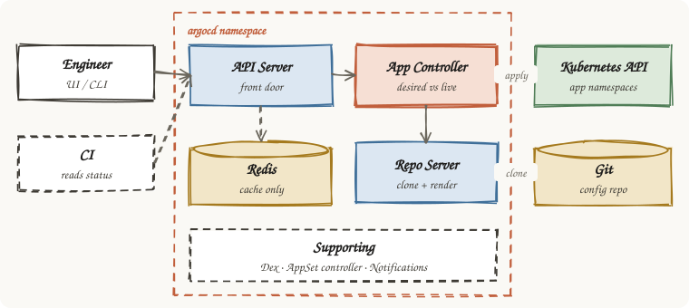

# 02 · Argo CD Architecture and Installation

> **Lab needs:** the local k3d cluster from [00-lab-setup.md](00-lab-setup.md).
>
> **Time:** ~45 min reading + ~60 min lab (first time) + 20 min revision

---

## TL;DR

1. **Argo CD** is a **Kubernetes-native GitOps controller**. It runs *inside* the cluster, extends Kubernetes with **CRDs** (`Application`, `AppProject`, `ApplicationSet`) and follows the controller pattern.
2. It **implements** GitOps. It does **not** build, test or replace CI. Its job starts once desired state is in Git.
3. **Scope is opt-in.** Argo CD manages only the apps you register. Other apps in the same cluster can still be push-deployed, so adoption can be incremental.
4. **Three core components:**
   - **API Server**: the front door (UI, CLI, REST/gRPC).
   - **Repo Server**: Git → rendered plain YAML. It never talks to the K8s API.
   - **Application Controller** (**the heart**): compares desired vs live state and reconciles.
5. **Supporting components:** **Redis** (cache only, not a source of truth), the **ApplicationSet controller** (generates many `Application`s), **Dex** (SSO via OIDC/SAML), and the **Notifications controller**.
6. **Users of Argo CD ≠ users of the cluster.** Argo CD admins and CI (which only *reads status*) use the Argo CD API, not the Kubernetes API.
7. One Argo CD can manage **many clusters** (hub-and-spoke). It's powerful, but it concentrates credentials, which is a compliance decision.
8. **Install:** Helm chart `argo/argo-cd`, **pinned version**, in its own `argocd` namespace. Access by port-forward (lab only), log in as `admin` with the password from `argocd-initial-admin-secret`, then change it.

---

## 1. GitOps recap: why a long-running controller is needed

| Principle | What it implies |
|---|---|
| **Declarative** | YAML/JSON manifests, not imperative `kubectl` commands. Otherwise there's no history of *what* was applied. |
| **Versioned and immutable** | Every commit is an immutable snapshot. *Immutable* doesn't mean "can't change the file"; it means you can always go back to any known-good version. |
| **Pulled automatically** | Something *in the environment* must fetch from Git. |
| **Continuously reconciled** | That something must **keep running** and compare Git with the cluster forever. |

→ The last two principles require a **long-running reconciliation controller**. That's the gap Argo CD fills.

---

## 2. What Argo CD is

> **Argo CD** is a Kubernetes-native continuous delivery tool that **implements** the GitOps operating model. It acts as an automated reconciler, making sure the **live state** (also called *current* or *running* state) always matches the **desired state** in Git.

### What "Kubernetes-native" means

Kubernetes is **extensible**. Anyone can plug in by following its standards:

1. Define a **CustomResourceDefinition (CRD)**: a new object *kind*, e.g. `kind: Application`.
2. Create **custom resources (CRs)** of that kind.
3. Run a **controller** that watches those CRs and acts on them.

Argo CD does exactly this, which is why you'll see its CRDs right after installing (lab step B4).

### Argo CD at a glance

| Aspect | Argo CD |
|---|---|
| **Type** | Kubernetes-native GitOps controller (control plane) |
| **Purpose** | Continuously reconcile cluster state with Git |
| **Model** | **Pull-based** |
| **Security** | CI has **no cluster credentials**. Argo CD holds *Git* credentials for private repos (in the repo server's config). |
| **Scope** | Only applications **explicitly registered** with it |
| **Behaviour** | Detects drift and enforces the declared state |
| **Role** | Enforces GitOps. **Does not build.** CI builds, tests, scans and publishes; Argo CD deploys. |

### Reading the diagram

- **Left:** CI does build-time work only. Its only touch point is **Git** (and optionally the Argo CD API, to *read* status).
- **Centre:** Git, with an **app repo** and a **config repo** per app. Argo CD watches **only the config repos**.
- **Right:** the cluster. `app1-ns` and `app2-ns` are reconciled by Argo CD.
- **Not shown:** `app3` and `app4` may live in the same cluster and still be deployed by Jenkins (push). **GitOps adoption is selective and incremental.** Teams migrate apps as they mature.

---

## 3. Architecture

<picture>
  <source media="(prefers-color-scheme: dark)" srcset="../images/argocd-architecture-dark.svg">
  
</picture>

*Three core components (API server, application controller, repo server) plus Redis and the supporting controllers.*

```
   DevOps engineer ──UI/CLI──┐        Jenkins/GHA ──REST (read status, optional)──┐
                             ▼                                                     ▼
                    ┌──────────────────────── argocd namespace ─────────────────────────┐
                    │  ┌────────────┐     ┌─────────────────┐     ┌──────────────────┐  │
                    │  │ API Server │◀───▶│ Application     │◀───▶│ Repo Server      │──┼──▶ Git (config repo)
                    │  │ (front     │     │ Controller ❤️   │     │ clone + render   │  │    creds for private repos
                    │  │  door)     │     │ desired vs live │     │ Helm/Kustomize → │  │
                    │  └────────────┘     └───────┬─────────┘     │ plain YAML       │  │
                    │        Redis (cache) · Dex (SSO) · AppSet ctrl · Notifications   │
                    └─────────────────────────────┼────────────────────────────────────┘
                                                  │ Kubernetes API (watch + apply)
                                                  ▼
                                   app1-ns: Deployment, ConfigMap, SA, PVC, Service
```

### Core components

| Component | Job | Talks to | Analogy |
|---|---|---|---|
| **API Server** (`argocd-server`) | Entry point for UI, CLI and CI. Serves **REST** (human-readable HTTP, used by UIs and scripts) and **gRPC** (fast binary protocol, service to service). Handles auth and coordinates the other components to answer requests. | Users, CI, internal components | The **web tier** of a 3-tier app; like the kube-apiserver, but for Argo CD |
| **Repository Server** (`argocd-repo-server`) | **Authenticates to Git**, clones the repo, **renders manifests** (Helm templates + values, Kustomize bases + overlays, plain YAML) into the plain YAML the K8s API understands. Answers: *"according to Git, what should the cluster look like?"* | **Git only.** Never the K8s API. | A compiler: source → output |
| **Application Controller** (`argocd-application-controller`) ❤️ | **The heart.** Watches `Application` CRs (Argo CD's object, *not* "your app"), gets desired state from the repo server, watches live state from the K8s API, **detects drift, syncs, self-heals, runs hooks**. The loop never stops. | Repo server + **Kubernetes API** (local or remote clusters) | The Deployment controller, but for "Git vs cluster" |

> 🧠 **Why does an `Application` name a destination cluster when Argo CD is already inside one?**
> Because **one Argo CD can deploy to many clusters**. Install it once in a "hub" cluster and register 10–15 "spoke" clusters (common when they share a cost centre).
> **Trade-off:** the hub then holds credentials for every spoke, so some security and compliance regimes forbid it and run one Argo CD per cluster instead. You'll use multi-cluster in lecture 10.

### Who needs access to what

| Actor | Needs Argo CD access? | Needs K8s cluster access? |
|---|---|---|
| Developer viewing app status | ✅ (read-only role) | ❌ |
| Argo CD admin | ✅ | ❌ normally. ✅ only to troubleshoot Argo CD itself (pods crash-looping, etc.) |
| CI (Jenkins) | Optional, **read-only**, to poll sync and health after a merge | ❌ |
| Argo CD (application controller) | — | ✅ the only thing that applies resources |

An analogy: using SonarQube doesn't require SSH access to the VM it runs on. **The app's users ≠ the host's admins.** Argo CD is just another app running in Kubernetes.

### Supporting components

They're not part of the reconciliation logic, but they matter for **scale, performance and enterprise access**.

| Component | Purpose | If it dies… |
|---|---|---|
| **argocd-redis** | **Cache** of rendered Git state and observed cluster state. Speeds up the UI, API and comparisons. | Slower and less responsive, then it rebuilds. **Git and K8s stay authoritative**, so no data is lost. |
| **argocd-applicationset-controller** | Reconciles **`ApplicationSet`** CRs → generates many `Application`s (multi-cluster, multi-env). Covered in lecture 10. | No new or updated generated apps. Existing apps keep syncing. |
| **argocd-dex-server** | **SSO** broker: OIDC, SAML, GitHub, LDAP… Keeps authentication separate from reconciliation. Covered in module 13. | SSO logins fail. The local `admin` still works if enabled. |
| **argocd-notifications-controller** | Slack, email and webhook alerts on sync or health events. Visible in the `kubectl get pods` output; covered in module 15. | No alerts. |

**Bottom line:** neither DevOps engineers nor CI deploy to Kubernetes. **Git is the handoff point; Argo CD is the enforcer.**

---

## 4. Where to run the lab

Use the local k3d cluster from [00-lab-setup.md](00-lab-setup.md) (sections 2.3–2.5 create the cluster and install Argo CD). The steps below walk through the same install slowly, explaining each piece. KIND, minikube or a cloud cluster work the same way: Argo CD can't tell a lightweight distribution like k3s apart from EKS.

---

## 5. Hands-on lab: install Argo CD step by step

Run everything in your terminal against the `dev` cluster (`kubectl config current-context` → `k3d-dev`). If you already installed Argo CD with [00-lab-setup.md](00-lab-setup.md), skip B2 and use the rest to explore.

### B1. Add the Helm repo

```bash
helm repo add argo https://argoproj.github.io/argo-helm   # register the official chart repo as "argo"
helm repo list                                            # confirm it's there
helm repo update                                          # refresh the local index (like apt update) — make it a habit
helm search repo argo                                     # "argo" keyword across ALL repos: argo-cd, argo-workflows, argo-rollouts…
helm search repo argo/argo-cd --versions | head -15       # every published version of the argo-cd chart
```
- **Notice two columns:** `CHART VERSION` (the Helm packaging, e.g. `9.1.9`) and `APP VERSION` (Argo CD itself, e.g. `v3.x.y`). They're **different numbers**, and interviews like to ask about this.
- **Where it comes from:** [Artifact Hub](https://artifacthub.io) → search `argo-cd` → filter **Official**.

### B2. Namespace + install

```bash
kubectl create ns argocd
helm install my-argo-cd argo/argo-cd --version 9.1.9 -n argocd --timeout 15m
```

| Piece | Meaning |
|---|---|
| `my-argo-cd` | **Release name.** It prefixes every object (`my-argo-cd-argocd-server`, …). |
| `argo/argo-cd` | repo/chart |
| `--version 9.1.9` | **Pin it.** Without it you get "latest", and every reinstall could be different. Version pinning is non-negotiable in CI and prod. |
| `-n argocd` | Dedicated namespace: separation, easier RBAC, and only Argo CD admins get access to it |
| `--timeout 15m` | The first install pulls many images; the default 5 minutes can time out on a laptop |

- **Expect:** `STATUS: deployed` and NOTES with port-forward and password instructions.
- **Tip:** `helm install … --create-namespace` combines both steps.

### B3. Map pods to the architecture

```bash
kubectl get pods -n argocd -w     # watch until all are Running (Ctrl+C to stop)
```

Fill in this table yourself. It's your architecture check:

| Pod name contains | Component | Core or supporting? |
|---|---|---|
| `application-controller-0` | | |
| `repo-server` | | |
| `server` | | |
| `redis` | | |
| `applicationset-controller` | | |
| `dex-server` | | |
| `notifications-controller` | | |

<details><summary>Answers + one extra observation</summary>

controller = **Application Controller** (core) · repo-server = **Repository Server** (core) · server = **API Server** (core) · redis, applicationset, dex and notifications are all supporting.

**Notice** the controller pod ends in `-0`: it's a **StatefulSet**, not a Deployment. That gives it a stable identity, which Argo CD uses to **shard** clusters across controller replicas at scale. Check it with:
```bash
kubectl get statefulset,deployment -n argocd
```
</details>

### B4. See the "Kubernetes-native" part

```bash
kubectl get crd | grep argoproj
kubectl api-resources --api-group=argoproj.io
```
- **Expect:** `applications.argoproj.io`, `applicationsets.argoproj.io`, `appprojects.argoproj.io`.
- **Why it matters:** these are the CRDs from section 2. In lecture 03 you'll write a `kind: Application`, and the application controller will act on it.

```bash
kubectl get appproject -n argocd       # a "default" project already exists (lecture 05 explains it)
kubectl get svc -n argocd              # find my-argo-cd-argocd-server: ports 80 and 443
```

### B5. Open the UI

In a **second terminal** (leave it running):
```bash
kubectl port-forward svc/my-argo-cd-argocd-server -n argocd 8443:443
```
- **What:** laptop `localhost:8443` → the K8s API → the `argocd-server` Service on 443.
- **Why 8443 and not 8080:** k3d publishes its built-in Traefik ingress on 8080. Forwarding Argo CD there fails or talks to Traefik.
- Browse to **https://localhost:8443**. The certificate is **self-signed**, so accept the warning ("Advanced → Proceed"). Plain `http://` is redirected to HTTPS.

### B6. Log in and change the password

In your working terminal:
```bash
kubectl -n argocd get secret argocd-initial-admin-secret \
  -o jsonpath="{.data.password}" | base64 -d; echo
```
- **What:** the chart generated a random admin password and stored it in a Secret. Secret values are **base64-encoded, not encrypted**; `base64 -d` decodes it.
- Log in as `admin` with that password → **User Info → Update Password**.

Then delete the bootstrap secret. Argo CD's own docs recommend this once you've changed the password, because it's no longer used:
```bash
kubectl -n argocd delete secret argocd-initial-admin-secret
```

### B7. (Optional) argocd CLI

```bash
argocd login localhost:8443 --insecure --username admin   # --insecure only because of the self-signed cert; run alone, it prompts
argocd version
argocd cluster list     # shows https://kubernetes.default.svc (in-cluster) — the destination you'll use in lecture 03
argocd account list
```
- The CLI talks to the **API server** (port-forward) over gRPC, not to the K8s API. That proves the "Argo CD access ≠ cluster access" point from section 3.
- **Got `rpc error: code = Unimplemented ... 404 ... text/plain`?** You're talking to Traefik on 8080. Use 8443.

### B8. Break it and observe (builds intuition)

```bash
kubectl -n argocd delete pod -l app.kubernetes.io/name=argocd-redis
kubectl -n argocd get pods -w
```
- **Predict before you run:** does Argo CD lose any configuration?
- **Answer:** no. The Deployment recreates the pod; Redis is **only a cache**, and the real state lives in Git and in K8s objects (CRs, Secrets, ConfigMaps). The UI may be sluggish for a few seconds.

```bash
kubectl -n argocd get cm argocd-cm -o yaml          # core settings (URL, repos, …) — config as a ConfigMap
kubectl -n argocd get cm argocd-rbac-cm -o yaml     # RBAC policies — module 13
```

### B9. End of session (always do this)

Ctrl+C the port-forward, then
```bash
k3d cluster stop dev     # frees ~2 GB RAM; `k3d cluster start dev` next time
```

---

## 6. Production reality and pitfalls

### Common claims, with nuance

| Common claim | Nuance |
|---|---|
| Open `http://localhost:<port>` | argocd-server serves **HTTPS** with a self-signed cert and redirects plain HTTP. Use `https://`. In prod, TLS terminates at an Ingress/ALB with a real certificate. |
| "Three supporting components" | There's a fourth: **notifications-controller**. It shows up in `kubectl get pods -n argocd`. |
| `kubectl create ns` then `helm install` | `--create-namespace` does both. In GitOps-managed platforms, the namespace is created declaratively anyway. |
| Repo server "does not interact with the Kubernetes API" | True for **applying** resources. That's the controller's job. The repo server only renders. |
| Argo CD "does not deploy applications" | It doesn't **build** them. It certainly applies them to the cluster. The phrase means "CI doesn't push deployments". |

### How production installs differ

| Area | Lab | Production |
|---|---|---|
| **Install method** | `helm install` by hand | Helm chart + a **`values.yaml` in Git**, version pinned. Ideally **Argo CD manages its own install** (module 12). |
| **Availability** | 1 replica each, single Redis | **HA:** `server` and `repo-server` with 2+ replicas + PDBs, **redis-ha**, controller **sharding** for many clusters. The chart has HA values. |
| **Access** | `kubectl port-forward` | **Ingress / AWS ALB + ACM certificate**, private DNS, often internal-only (VPN). Set `server.insecure=true` *only* when TLS terminates at the load balancer. |
| **Authentication** | Local `admin` | **SSO** (Dex or direct OIDC: Okta, Entra ID, Google, GitHub). **Disable `admin`** after SSO works (`admin.enabled: "false"`). |
| **Authorization** | admin = everything | `argocd-rbac-cm` + AppProject roles. Read-only for devs, sync for app teams, admin for the platform team (modules 5 and 13). |
| **Topology** | One cluster | **Hub-and-spoke** (one Argo CD, many clusters) vs **per-cluster** Argo CD. Hub = central view, but one place holds every cluster credential. Per-cluster = isolation, but N instances to run. Regulated industries often choose per-cluster or per-environment. |
| **Upgrades** | — | Argo CD releases a new minor about **every 3 months** and supports the last 3 minors. Read the upgrade notes, bump the chart in Git, roll out dev → prod. |
| **Observability** | — | Prometheus metrics (`argocd_app_info`, sync and health status), alerts on `OutOfSync`/`Degraded` (module 16). |
| **Resources** | defaults | Set requests and limits. The **repo-server** is CPU and memory hungry with big Helm or Kustomize repos; the **controller** with many apps. |

### Stateful lens: what state does Argo CD itself hold?

Argo CD is close to **stateless**:

| Where state lives | What | Backup? |
|---|---|---|
| **Git** | All desired state | That's Git's job |
| **K8s objects in `argocd` ns** | `Application`/`AppProject` CRs, repo and cluster credentials (Secrets), settings (ConfigMaps) | `argocd admin export > backup.yaml`, or better, keep **everything declarative in Git** (module 12) so that rebuilding = re-sync |
| **Redis** | Cache only | **No.** It's disposable (you prove it in B8). |

→ That's why "rebuild Argo CD from Git" is the gold-standard DR for it.

### Common mistakes

1. Installing without `--version`, so environments drift between reinstalls.
2. Exposing argocd-server with a public `LoadBalancer` and the default admin enabled.
3. Giving everyone `kubectl` access "for debugging", which bypasses the GitOps security model.
4. Mixing up **chart version** and **app version** during upgrades.
5. Leaving `argocd-initial-admin-secret` around after changing the password.
6. Forwarding Argo CD to a port another service already uses (k3d's Traefik on 8080).

---

## 7. Revision kit

### Command cheat sheet

| Command | Purpose |
|---|---|
| `helm repo add/update/list`, `helm search repo argo/argo-cd --versions` | Manage chart repos and versions |
| `helm install my-argo-cd argo/argo-cd --version 9.1.9 -n argocd` | Install Argo CD |
| `helm list -n argocd` / `helm uninstall my-argo-cd -n argocd` | See / remove releases |
| `kubectl get pods,svc,sts,deploy -n argocd` | Inspect components |
| `kubectl get crd \| grep argoproj` | Argo CD's CRDs |
| `kubectl port-forward svc/my-argo-cd-argocd-server -n argocd 8443:443` | UI access (lab only) |
| `kubectl -n argocd get secret argocd-initial-admin-secret -o jsonpath="{.data.password}" \| base64 -d` | Initial admin password |
| `argocd login localhost:8443 --insecure` / `argocd cluster list` | CLI login / list destination clusters |

### Self-test

<details><summary><b>Q1.</b> What does "Kubernetes-native" mean for Argo CD?</summary>

It runs inside the cluster and extends Kubernetes the standard way: CRDs (`Application`, `AppProject`, `ApplicationSet`) + custom resources + controllers that watch them.
</details>

<details><summary><b>Q2.</b> Name the 3 core components and what each one talks to.</summary>

**API Server**: UI, CLI and CI (REST/gRPC). **Repo Server**: Git only (clone + render). **Application Controller**: repo server + the Kubernetes API (compare, sync, self-heal).
</details>

<details><summary><b>Q3.</b> Which component renders Helm charts and Kustomize overlays into YAML?</summary>

The **Repository Server**.
</details>

<details><summary><b>Q4.</b> Which component is "the heart", and why?</summary>

The **Application Controller**. It holds the reconciliation loop: desired (from the repo server) vs live (from the K8s API), drift detection, sync, self-heal and hooks.
</details>

<details><summary><b>Q5.</b> Redis pod deleted: what's lost?</summary>

Nothing permanent. It's a cache of rendered and observed state, and it rebuilds. Git and K8s are authoritative.
</details>

<details><summary><b>Q6.</b> What do the ApplicationSet controller and Dex do?</summary>

The ApplicationSet controller generates many `Application`s from templates and generators (multi-cluster, multi-env). Dex brokers SSO (OIDC/SAML) so Argo CD can use an external identity provider.
</details>

<details><summary><b>Q7.</b> Why might a CI pipeline call the Argo CD API, and why doesn't that break GitOps?</summary>

To **read** sync and health status after merging a config change (e.g. to gate the next stage). It never deploys and never touches the K8s API, so Git is still the only path for changes.
</details>

<details><summary><b>Q8.</b> Why does an <code>Application</code> specify a destination cluster?</summary>

One Argo CD can manage many clusters (hub-and-spoke). The destination says which one. The in-cluster default is `https://kubernetes.default.svc`.
</details>

<details><summary><b>Q9.</b> Chart version vs app version?</summary>

Chart version = the Helm package's own version (e.g. 9.1.9). App version = the Argo CD release inside it (e.g. v3.x). Pin the chart version. Each chart version maps to one app version.
</details>

<details><summary><b>Q10.</b> The controller pod ends in <code>-0</code>. Why?</summary>

It's a **StatefulSet**, not a Deployment. A stable identity lets Argo CD **shard** clusters across several controller replicas at scale.
</details>

### Interview questions

<details><summary><b>I1.</b> "Explain Argo CD's architecture."</summary>

Argo CD is a set of controllers in the cluster. The **API server** is the front door for the UI, CLI and automation (gRPC/REST) and handles authentication. The **repo server** clones Git and renders manifests (Helm, Kustomize, plain YAML) and never touches the cluster. The **application controller** watches `Application` CRs, compares the rendered desired state with live state from the K8s API, and syncs or self-heals. Supporting pieces: Redis (cache), the ApplicationSet controller (templated apps), Dex (SSO) and the notifications controller.
</details>

<details><summary><b>I2.</b> "How would you install Argo CD for production?"</summary>

Helm chart pinned to a version, values in Git; ideally Argo CD manages itself. Use HA values (multiple server and repo-server replicas, redis-ha, PDBs, controller sharding if many clusters). Expose it through an Ingress/ALB with a real certificate, internal only. Turn on SSO and disable local admin, define RBAC per team and AppProject, set resource requests and limits, scrape Prometheus metrics, and alert on OutOfSync and Degraded. Upgrade on a cadence, dev → prod.
</details>

<details><summary><b>I3.</b> "Hub-and-spoke vs one Argo CD per cluster?"</summary>

Hub: a single pane of glass, less to operate, and ApplicationSets across clusters; but the hub stores every cluster's credentials (blast radius, compliance) and is a single point of failure. Per-cluster: strong isolation and simpler security reviews, but N instances to upgrade and monitor. Common middle ground: one Argo CD per environment tier (non-prod hub + prod hub).
</details>

<details><summary><b>I4.</b> "Argo CD is down. Are your apps down?"</summary>

No. Workloads keep running; Argo CD isn't in the data path. What stops is new syncs, drift correction and the UI. Recovery is easy because its state is Git plus K8s objects (and Redis is just a cache).
</details>

<details><summary><b>I5.</b> "How do you access a private cluster without opening SSH or the API to the internet?"</summary>

AWS SSM Session Manager (or a bastion/VPN). The agent dials out, IAM controls who can start sessions, CloudTrail logs them, and port forwarding gives kubectl access to the API through the session. On EKS, use a private endpoint plus SSM, VPN, or a CI runner inside the VPC.
</details>

---

## 8. Before lecture 03

- [ ] Argo CD installed, admin password changed, initial secret deleted
- [ ] B3 table filled in from memory
- [ ] Can draw the architecture on paper: 3 core + 4 supporting components and who talks to whom
- [ ] Cluster stopped at the end of the session (B9)
