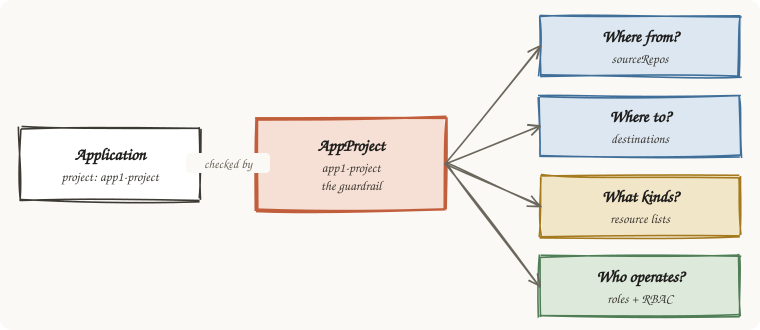
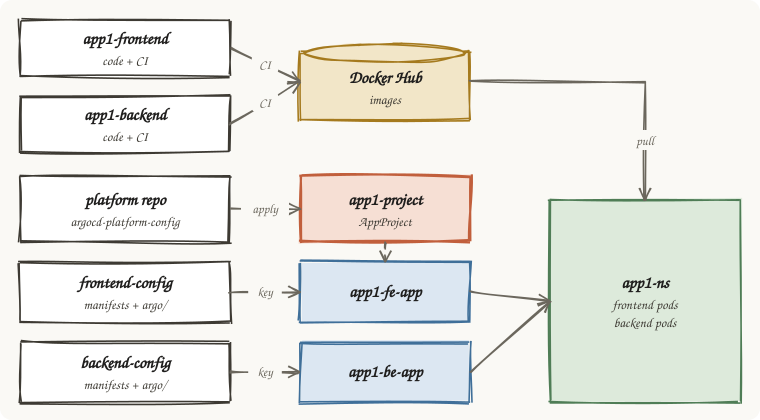

# 05 · AppProjects: Guardrails, Destinations, Resource Kinds and RBAC

> **Lab files:** [`labs/05-projects/`](../labs/05-projects): five repos (two app code, two config, one platform), **private repos read through SSH deploy keys**, images built by **GitHub Actions**, plus three guardrail tests.
>
> **Lab needs:** local k3d `dev` + Argo CD on **https://localhost:8443** ([00-lab-setup.md](00-lab-setup.md)) + GitHub + Docker Hub
>
> **Time:** ~1.4 h reading + ~2 h lab + 30 min revision

---

## TL;DR

1. Every Application belongs to **exactly one AppProject**. Until now that was `default`, which allows **anything, from anywhere, to anywhere**: fine for learning, unsafe for production.
2. An **AppProject is a guardrail, not a folder.** It answers four questions about every Application that references it:

   | Question | Field | Checked |
   |---|---|---|
   | **Where** may manifests come from? | `sourceRepos` | When the Application spec is validated (before any sync) |
   | **Where** may they be deployed? | `destinations` (cluster + namespace globs) | When the Application spec is validated |
   | **What** kinds may be created? | `clusterResourceWhitelist/Blacklist`, `namespaceResourceWhitelist/Blacklist` | Per resource, at sync time |
   | **Who** may operate the apps? | `roles` (Argo CD RBAC policies + SSO groups) | On every UI/CLI/API action |

3. **Implicit deny:**
   - **Cluster-scoped** kinds are denied unless whitelisted.
   - **Namespaced** kinds are all allowed *until* you add a `namespaceResourceWhitelist`. From then on, only the listed kinds are allowed.
4. **Argo CD RBAC ≠ Kubernetes RBAC.** Kubernetes RBAC can say who may `create` an `Application` object. It has no idea what "sync", "refresh", "rollback" or "prune" mean. Argo CD RBAC (global `argocd-rbac-cm` + project roles) governs those GitOps actions.
5. Projects govern **Argo CD**, not Kubernetes. Someone with cluster-admin can still `kubectl apply` directly, or edit the AppProject. Projects stop *GitOps mistakes and abuse*; Kubernetes RBAC and admission policies stop the rest.
6. **Order matters:** platform team creates the **AppProject first**, then app teams create Applications inside it.

---

## 1. Why projects? (the five problems of the `default` project)

| Problem | Example |
|---|---|
| **Unrestricted source repos** | A tired engineer points an Application at a personal fork, and unreviewed YAML reaches the cluster |
| **Uncontrolled destinations** | With 10–15 clusters behind one Argo CD, a dev workload lands in the **prod** cluster |
| **No resource-level safety** | A commit adds a `ClusterRoleBinding` to cluster-admin, and Argo CD (which runs with broad rights) applies it |
| **No application-level RBAC** | A frontend developer syncs or deletes the backend team's app |
| **Single-tenant trust** | 50 apps share one permission model: no segregation by criticality or team |

> **Scale note:** with 10–20 services, conventions and tribal knowledge keep you safe. With hundreds of services and many teams, these gaps become security and operational incidents.

---

## 2. What an AppProject is

<picture>
  <source media="(prefers-color-scheme: dark)" srcset="../images/appproject-questions-dark.svg">
  
</picture>

*Every Application is checked against its project: where from, where to, what kinds, who.*

- A **CRD** (`AppProject`, group `argoproj.io`, short name `appproj`), created in the **`argocd` namespace**. You saw it in lecture 03's `kubectl api-resources | grep -i argo`.
- **Not a namespace.** It creates nothing in the cluster and isolates nothing at runtime. Namespaces still do runtime isolation, quotas and network boundaries.
- **Declarative**, so it lives in Git like everything else: here in a separate **platform repo** (`argocd-platform-config`), owned by the platform team.
- **The `default` project:**

  - Created at install, can't be deleted, `*` for repos and destinations, every kind allowed.
  - Usual advice: leave it untouched and create explicit projects. **Production advice:** also **lock it down** (empty `sourceRepos`/`destinations`), otherwise any Application can escape your guardrails just by writing `project: default` (see section 6).

### Projects model *policy*, not app names

These notes use one project per application (`app1-project`). Equally common:
- Per environment: `app1-dev`, `app1-prod` (different destinations and roles)
- Shared: `dev-project` for all dev workloads (`destinations: dev-*`), `prod-project` for prod

Pick the boundary where **rules and owners change**.

---

## 3. The AppProject, field by field

Your lab version: [`labs/05-projects/argocd-platform-config/app1-appproj.yaml`](../labs/05-projects/argocd-platform-config/app1-appproj.yaml)

```yaml
apiVersion: argoproj.io/v1alpha1
kind: AppProject
metadata:
  name: app1-project
  namespace: argocd
spec:
  description: Project for App1 frontend and backend workloads
  sourceRepos:
    - git@github.com:<GITHUB_USER>/app1-frontend-config.git
    - git@github.com:<GITHUB_USER>/app1-backend-config.git
  destinations:
    - namespace: app1-*
      server: https://kubernetes.default.svc
  clusterResourceWhitelist:
    - group: ""
      kind: Namespace
  namespaceResourceWhitelist:
    - { group: apps, kind: Deployment }
    - { group: "",   kind: Service }
    - { group: "",   kind: ConfigMap }
    - { group: "",   kind: Secret }
  clusterResourceBlacklist:
    - { group: rbac.authorization.k8s.io, kind: ClusterRole }
    - { group: rbac.authorization.k8s.io, kind: ClusterRoleBinding }
  roles:
    - name: dev-readonly
      policies:
        - p, proj:app1-project:dev-readonly, applications, get, app1-project/*, allow
      groups: [app1-devs]
    - name: platform-admin
      policies:
        - p, proj:app1-project:platform-admin, applications, *, app1-project/*, allow
      groups: [platform-team]
```

| Field | Meaning | Gotcha |
|---|---|---|
| `sourceRepos` | The **only** repos Applications in this project may use. Globs allowed (`git@github.com:my-org/*`). | Must match the Application's `repoURL` **string**: `https://github.com/x/y.git` and `git@github.com:x/y.git` are **different** repos to this check. |
| `destinations` | Allowed `server` (or `name`) + `namespace` pairs, globs allowed | `app1-*` allows `app1-ns`, `app1-dev`, `app1-prod`… but not `app1` itself |
| `clusterResourceWhitelist` | Cluster-scoped kinds allowed (`Namespace`) | Empty/absent = **no** cluster-scoped kinds at all |
| `namespaceResourceWhitelist` | Namespaced kinds allowed | Absent = all namespaced kinds; present = **only** these |
| `*Blacklist` | Explicit hard denies | Redundant next to a whitelist, but documents intent and survives a later `"*"` whitelist |
| `roles` | Project-scoped Argo CD RBAC | `groups` match **SSO group claims** (module 13), not local accounts |

### `group` and `kind`
`kind` is the resource kind. `group` is its **API group**, the part of `apiVersion` before the `/`:

| apiVersion | group to write |
|---|---|
| `v1` (core: Service, ConfigMap, Secret, Namespace, PV, PVC) | `""` |
| `apps/v1` (Deployment, StatefulSet, DaemonSet) | `apps` |
| `rbac.authorization.k8s.io/v1` | `rbac.authorization.k8s.io` |
| `networking.k8s.io/v1` (Ingress) | `networking.k8s.io` |

Find any kind's group and scope with `kubectl api-resources` (the **APIVERSION** and **NAMESPACED** columns).

### Argo CD RBAC policy syntax (Casbin)

```
p, <subject>,                          <resource>,   <action>, <object>,         <effect>
p, proj:app1-project:platform-admin,   applications, *,        app1-project/*,   allow
```

| Part | Here | Notes |
|---|---|---|
| subject | `proj:<project>:<role>` | Inside a project, the subject is always the project role |
| resource | `applications` | Others: `applicationsets`, `projects`, `repositories`, `clusters`, `logs`, `exec`… |
| action | `get`, `create`, `update`, `delete`, `sync`, `override`, `action/…`, `*` | |
| object | `<project>/<app>` | `app1-project/*` = every app in the project |
| effect | `allow` / `deny` | deny wins |

`g, <user-or-group>, <role>` lines bind subjects to roles (used in section 5 step 5.13).

### Where users and groups come from
- **Production:** an identity provider (Entra ID / Active Directory, Okta, Google, Keycloak, AWS IAM Identity Center) via **OIDC or SAML through Dex**. Argo CD gets the user's **groups** at login, and project roles map those groups to permissions. Argo CD doesn't manage users or groups itself.
- **Local accounts** (`accounts.<name>` in `argocd-cm`): no groups, no self-service. Only for bootstrap, break-glass and automation tokens. Production usually disables `admin` once SSO works.

---

## 4. The lab: a two-tier app in five repos

<picture>
  <source media="(prefers-color-scheme: dark)" srcset="../images/five-repos-dark.svg">
  
</picture>

*Code repos build images; config repos feed the Applications over deploy keys; the platform repo defines the project that guards them.*

### Repo patterns

| Pattern | Repos | Fits |
|---|---|---|
| 2 repos | `app1-code` (fe/ + be/) + `app1-config` (fe/ + be/) | Small teams, shared lifecycle |
| 3 repos | fe code + be code + one shared config | Separate CI per tier, shared GitOps config |
| **5 repos** (used here) | fe code + be code + fe config + be config + **platform** | Large orgs: separation of duties, smallest blast radius per change |

The fifth repo, **`argocd-platform-config`**, holds the AppProject, because the project belongs to **app1 as a whole**, not to one tier. Later lectures add more platform objects to it.

### The app

```
browser ──▶ frontend-svc:80 ──▶ frontend pod :4000 ──GET http://backend-svc:5000/api/message──▶ backend pod :5000
```
- **backend** (`app.py`): `GET /api/message` → `{"service":"backend","message":"Hello from Backend API",…}`
- **frontend** (`app.py`): `GET /` calls the backend and returns both messages. The backend URL comes from the `BACKEND_URL` env var in `deploy.yaml`.

### Applications live in `argo/`, outside the synced path
Each config repo has `argo/` (the Application) and `frontend/` or `backend/` (the manifests). The Application syncs **only** `frontend/` or `backend/`:
- Unlike lecture 04's `path: .`, these Applications **do not manage themselves**. You apply them by hand once; editing `argo/*.yaml` in Git changes nothing until you re-apply.
- The fix comes later: App of Apps (lecture 09) or ApplicationSets (lecture 10) manage Applications from Git without self-reconciliation.

---

## 5. Hands-on lab (k3d + private GitHub + Docker Hub)

> Argo CD is on **8443** (8080 is k3d's Traefik). Run any command that **prompts** (logins, passwords) **on its own**, never in a multi-line paste.

### 5.0 Session start, and retire lecture 04's app1 (recommended)
[00-lab-setup.md section 5](00-lab-setup.md#5-session-routine-every-lab): `k3d cluster start dev` → port-forward `8443:443` → `argocd login localhost:8443 --insecure --username admin`. Then `cd <this repo> && export NOTES=$PWD`.

Lecture 04's `app1` also lives in `app1-ns`. Delete it to free RAM and keep `app1-ns` clean (its GitHub repos stay):

UI → `app1` → **Delete** → type `app1` → propagation **Foreground** → OK.
```bash
kubectl get app -n argocd          # app1 gone
kubectl get all -n app1-ns         # its Deployment and pods gone
```
- **Why it cascades:** a UI delete cascades by default (lecture 03 delete trap). The namespace `app1-ns` and `dockerhub-secret` remain, because you created them by hand.
- **Stuck in deletion** (`OutOfSync Missing`, `deletionTimestamp` set)? The self-managed app waits on its own foreground finalizer. Confirm nothing is left (`kubectl get all -n app1-ns`), then `kubectl patch app app1 -n argocd --type json -p '[{"op":"remove","path":"/metadata/finalizers"}]'`.

### 5.1 Create five private repos
```bash
for r in app1-frontend app1-backend app1-frontend-config app1-backend-config argocd-platform-config; do
  gh repo create "<GITHUB_USER>/$r" --private
done
gh repo list <GITHUB_USER> --limit 10
```

### 5.2 Copy the lab files
```bash
cp -r "$NOTES"/labs/05-projects/{app1-frontend,app1-backend,app1-frontend-config,app1-backend-config,argocd-platform-config} ~/gitops/
ls ~/gitops
grep -rl "<GITHUB_USER>\|<DOCKERHUB_USER>" ~/gitops/app1-*-config ~/gitops/argocd-platform-config
```
Replace the placeholders in the listed files (see the repo README), then check one Application and one Deployment.
- `{a,b,c}` is **brace expansion**: bash turns it into five separate paths.
- The code repos have no placeholders: the workflow builds `${{ vars.DOCKERHUB_USERNAME }}/${{ github.event.repository.name }}`, so both workflow files are identical.

### 5.3 CI credentials and public image repos
- Docker Hub → **Create repository** → `app1-frontend` (**Public**) and `app1-backend` (**Public**). The free plan's one private repo is taken by `app1`; these images contain no secrets.
- Both code repos need the same CI credentials as lecture 04 (`gha-push` token):
```bash
for r in app1-frontend app1-backend; do
  gh variable set DOCKERHUB_USERNAME --body "<DOCKERHUB_USER>" --repo "<GITHUB_USER>/$r"
done
gh secret set DOCKERHUB_TOKEN --repo <GITHUB_USER>/app1-frontend     # prompts: paste gha-push
gh secret set DOCKERHUB_TOKEN --repo <GITHUB_USER>/app1-backend      # prompts: paste gha-push
```

### 5.4 Push the code repos and release v1.0.0
```bash
for r in app1-frontend app1-backend; do
  cd ~/gitops/$r
  git init -b main && git add . && git commit -m "$r: flask app, Dockerfile, CI"
  git remote add origin "https://github.com/<GITHUB_USER>/$r.git"
  git push -u origin main
  git tag v1.0.0 && git push origin v1.0.0
done
gh run list --repo <GITHUB_USER>/app1-frontend --limit 1
gh run list --repo <GITHUB_USER>/app1-backend  --limit 1
```
- **Expect:** both runs green; Docker Hub shows `v1.0.0` and `sha-…` (no `latest`) in both repos.
- **The workflow is identical in both repos:** the image name is `${{ github.event.repository.name }}`.

### 5.5 Guardrails first: push the platform repo and apply the AppProject
```bash
cd ~/gitops/argocd-platform-config
git init -b main && git add . && git commit -m "app1-project: guardrails for app1"
git remote add origin https://github.com/<GITHUB_USER>/argocd-platform-config.git
git push -u origin main
kubectl get ns app1-ns || kubectl create ns app1-ns
kubectl apply -f app1-appproj.yaml
kubectl get appproj -n argocd
```
- **Expect:** `app1-project` and `default`.
- UI → **Settings → Projects**: compare `default` (`*` everywhere) with `app1-project` (your rules).
- **Why apply by hand:** nothing syncs the platform repo yet. In lecture 09 an app-of-apps does it.

### 5.6 Push the config repos
Push them **before** connecting them: Argo CD refuses to connect an **empty** repo (there are no refs to read).
```bash
for r in app1-frontend-config app1-backend-config; do
  cd ~/gitops/$r
  git init -b main && git add . && git commit -m "$r: manifests + Argo CD Application"
  git remote add origin "https://github.com/<GITHUB_USER>/$r.git"
  git push -u origin main
done
```
Nothing deploys yet: no Application exists.

### 5.7 Give Argo CD read access: one deploy key per config repo
GitHub refuses the same key on two repos (lecture 04), so make two:
```bash
ssh-keygen -t ed25519 -f ~/.ssh/argocd-app1-frontend-config -N "" -C "argocd@k3d-dev"
ssh-keygen -t ed25519 -f ~/.ssh/argocd-app1-backend-config  -N "" -C "argocd@k3d-dev"
```
Add each public key to its repo (read-only by default):
```bash
gh repo deploy-key add ~/.ssh/argocd-app1-frontend-config.pub --repo <GITHUB_USER>/app1-frontend-config --title "argocd k3d-dev"
gh repo deploy-key add ~/.ssh/argocd-app1-backend-config.pub  --repo <GITHUB_USER>/app1-backend-config  --title "argocd k3d-dev"
```
(Web UI alternative: repo → **Settings → Deploy keys → Add deploy key** → paste the **`.pub`**, write access **unticked**.)

Then UI → **Settings → Repositories → + CONNECT REPO → VIA SSH**, once per repo:

| Field | frontend | backend |
|---|---|---|
| Name | `app1-frontend-config` | `app1-backend-config` |
| Project | `app1-project` | `app1-project` |
| URL | `git@github.com:<GITHUB_USER>/app1-frontend-config.git` | `git@github.com:<GITHUB_USER>/app1-backend-config.git` |
| Key | `clip < ~/.ssh/argocd-app1-frontend-config` → Ctrl+V | `clip < ~/.ssh/argocd-app1-backend-config` → Ctrl+V |

Clear the clipboard afterwards (`echo -n | clip`).
- **Project = `app1-project`** makes it a **project-scoped repository**: only apps in that project can use this credential.
- **Expect:** both SSH repos **Successful** (`argocd repo list` or the UI).

### 5.8 Create the Applications
```bash
kubectl apply -f ~/gitops/app1-backend-config/argo/app1-be-app-crd.yaml
kubectl apply -f ~/gitops/app1-frontend-config/argo/app1-fe-app-crd.yaml
kubectl get app -n argocd
```
- **Expect:** within ~3 minutes (or click **Refresh**), both **Synced + Healthy**. Automated sync is on in both, so no Sync click is needed.
- UI → each app → **App Details → Project**: `app1-project`.

### 5.9 Use the app
```bash
kubectl get all -n app1-ns
kubectl port-forward -n app1-ns svc/frontend-svc 8081:80
```
In another terminal:
```bash
curl -s localhost:8081; echo
```
- **Expect:** `{"service":"frontend","ui_message":"Hello from Frontend","backend_response":{"message":"Hello from Backend API",…}}`. The frontend reached the backend through the `backend-svc` **Service DNS name**.

### 5.10 Test 1: forbidden kinds (PV and PVC)
```bash
cp "$NOTES/labs/05-projects/tests/pv-pvc.yaml" ~/gitops/app1-backend-config/backend/
cd ~/gitops/app1-backend-config
git add backend/pv-pvc.yaml && git commit -m "test: try PV + PVC" && git push
argocd app get app1-be-app --refresh > /dev/null
argocd app get app1-be-app
```
- **Expect:** OutOfSync, sync **failed**: `PersistentVolume "app1-backend-pv" is not permitted in project "app1-project"` and the same for the PVC.
- **Why both fail:** the PV is cluster-scoped and only `Namespace` is whitelisted; the PVC is namespaced and not in the namespaced whitelist.
- **Nothing is applied, and the rest keeps running:** one forbidden kind fails the whole sync before anything is applied, so the backend Deployment and Service are untouched.

Revert:
```bash
git rm backend/pv-pvc.yaml && git commit -m "test: remove PV + PVC" && git push
argocd app get app1-be-app --refresh > /dev/null
```
If it stays on the failed operation, run one manual sync (UI **Sync**).

### 5.11 Test 2 and 3: untrusted repo, forbidden destination
The test files contain `<GITHUB_USER>`: copy them and replace it first.
```bash
mkdir -p ~/gitops/tests && cp "$NOTES"/labs/05-projects/tests/{rogue-repo-app,wrong-dest-app}.yaml ~/gitops/tests/
cd ~/gitops/tests          # replace <GITHUB_USER> in both files, then:
kubectl apply -f rogue-repo-app.yaml
kubectl apply -f wrong-dest-app.yaml
argocd app get app1-rogue-repo | grep -i -A2 condition
argocd app get app1-wrong-dest | grep -i -A2 condition
```
- **Expect:** both **Unknown** with an `InvalidSpecError`: *repo … is not permitted in project* and *destination … namespace default … is not permitted*. Nothing is deployed.
- **Note test 2:** Argo CD *has* credentials for `app1-config` (lecture 04 deploy key). Having access isn't enough; the **project** must trust the repo.
- **Why `kubectl apply` creates them at all:** kubectl goes straight to Kubernetes, so the Application object exists and only the controller refuses it. Through the Argo CD UI or CLI, the API server checks the project at creation and rejects it outright.

Clean up:
```bash
kubectl delete -f rogue-repo-app.yaml -f wrong-dest-app.yaml
```

### 5.12 RBAC: a user with no role sees nothing
**1. Look at the current RBAC config first:**
```bash
kubectl get cm argocd-rbac-cm -n argocd -o yaml
```
Note `policy.default` (empty = no permissions for unmapped users) and `policy.csv`.

**2. Create a local account `dev1` with UI login:**
```bash
kubectl patch cm argocd-cm -n argocd --type merge -p '{"data":{"accounts.dev1":"login"}}'
argocd account list
```
⚠️ `argocd-cm` is owned by your **Helm release**. A future `helm upgrade` overwrites hand edits. The durable way is the chart value `configs.cm."accounts.dev1"`. Fine for a lab.

**3. Set its password** (run alone; it prompts for **your admin password**, then the new one twice):
```bash
argocd account update-password --account dev1
```

**4. Log in as `dev1`** in a **private browser window** (keep admin in the normal window): https://localhost:8443
- **Expect:** login works, **no applications are visible.** Authentication succeeded; authorization gave nothing (deny by default).

### 5.13 RBAC: grant read-only on app1-project
Project roles map **SSO groups**, and a local account has none, so bind `dev1` with a **global** policy scoped to the project:
```bash
kubectl patch cm argocd-rbac-cm -n argocd --type merge -p '{"data":{"policy.csv":"p, role:app1-viewer, applications, get, app1-project/*, allow\ng, dev1, role:app1-viewer\n"}}'
```
⚠️ This **replaces** `policy.csv`. If step 5.12.1 showed existing lines, add them to the string.

Refresh the private window:
- **Expect:** `app1-fe-app` and `app1-be-app` visible.
- Click **Sync** → **permission denied**. Delete is denied too.

**Check it from the CLI as admin:**
```bash
argocd admin settings rbac can dev1 get  applications 'app1-project/app1-be-app' --namespace argocd
argocd admin settings rbac can dev1 sync applications 'app1-project/app1-be-app' --namespace argocd
```
- **Expect:** `Yes`, then `No`.

### 5.14 End of session
Keep app1-fe/be running for lectures 06–07 (they extend these repos). Then:
```bash
k3d cluster stop dev      # Ctrl+C port-forwards first
```

---

## 6. Production reality and pitfalls

### Clarifications on the lecture

| Common claim or shortcut | Nuance |
|---|---|
| "Even Kubernetes cluster-admin privileges cannot bypass Project enforcement" | True for **Argo CD actions**. A cluster-admin can still `kubectl apply` directly, or edit the AppProject. Protect AppProjects with Kubernetes RBAC on the `argocd` namespace and GitOps review on the platform repo, and enforce cluster policy with admission controllers (Kyverno/Gatekeeper). |
| "Projects are evaluated before reconciliation" | Repo and destination checks happen when the Application spec is validated, so nothing is even compared. **Kind** checks happen **per resource when a sync starts**: one forbidden kind fails the whole sync **before anything is applied**, so the allowed resources aren't updated either (you saw this in test 1: the backend stayed as it was). |
| Health showed **Healthy** before the repos had files | Health of **zero resources** is Healthy. Read sync status and health together (lecture 04). |
| Public repos and a laptop `docker build` are enough for a demo | Real setups use private repos read through deploy keys (or a GitHub App) and CI-built images, as this lab does |
| `deploy.yaml` hardcodes `namespace: app1-ns` | Works, but undoes lecture 03's environment-agnostic manifests. Prefer no namespace in manifests and let `destination.namespace` decide. |
| The blacklist "is not needed" | Correct today; useful if the whitelist ever becomes `"*"` |
| "Leave the default project untouched" | Also **restrict** it, or anyone who can create Applications escapes all guardrails by writing `project: default` |

### What changes in real companies
- **Lock down `default`:** `sourceRepos: []`, `destinations: []`, no cluster resources, so every app must pick a real project.
- **Projects at scale:** per team or per environment, created from the platform repo by an app-of-apps or ApplicationSet (lectures 09–10), never by hand.
- **Repo globs:** `sourceRepos: ["git@github.com:my-org/app1-*"]` plus a **repo-creds template** (or GitHub App) so new repos don't need new credentials.
- **More project features:** `syncWindows` (no deploys on Friday night), `orphanedResources` (warn about unmanaged objects in your namespaces), `signatureKeys` (only GPG-signed commits), `sourceNamespaces` (apps-in-any-namespace for team self-service).
- **RBAC in production:** SSO groups → project roles, `policy.default: ''`, admin disabled after bootstrap, and CI uses **project tokens** (`argocd proj role create-token`) scoped to one project and action.

### Stateful lens
- A **stateful** app needs more kinds: `StatefulSet` (`apps`), `PersistentVolumeClaim` (`""`). Whitelist them in *its* project, not globally.
- Keep **PersistentVolume** (cluster-scoped) out of app projects. Storage should come from a **StorageClass** (dynamic provisioning), not hand-made PVs.
- For **RDS**-backed apps, the project needs `ExternalSecret` (`external-secrets.io`) instead of PVCs. The database itself is Terraform's, outside every project.
- Use separate projects for data workloads and stateless services, with stricter roles: fewer people should be able to sync or delete anything holding data.

### Common mistakes
1. `sourceRepos` uses `https://…` while the Application uses `git@…` (or the reverse) → *repo not permitted*.
2. Destination glob `app1-*` but the namespace is `app1` → *destination not permitted*.
3. Forgetting `Namespace` in `clusterResourceWhitelist` while using `CreateNamespace=true` or a `Namespace` manifest.
4. Adding a whitelist and forgetting a kind the app needs (`Ingress`, `HorizontalPodAutoscaler`, `ServiceAccount`) → partial sync failure.
5. Expecting project role `groups` to work for local accounts.

---

## 7. Revision kit

### Command cheat sheet
```bash
kubectl get appproj -n argocd                       # list projects
kubectl describe appproj app1-project -n argocd     # rules + roles
argocd proj list
argocd proj get app1-project
argocd app get <app> | grep -i -A2 condition        # InvalidSpecError reasons
argocd account list                                 # local accounts
argocd account update-password --account <name>     # prompts
argocd admin settings rbac can <user> <action> applications '<proj>/<app>' --namespace argocd
kubectl api-resources -o wide                       # kind, group, namespaced, verbs
```

### Self-test
1. Name the four questions an AppProject answers and the field for each.
2. Your project has no `namespaceResourceWhitelist`. Can an app create a `NetworkPolicy`? A `ClusterRole`?
3. Why did the PV *and* the PVC both fail in test 1?
4. Argo CD had working credentials for `app1-config`, yet `app1-rogue-repo` failed. Why?
5. Why can't Kubernetes RBAC stop a developer from clicking **Sync**?
6. `dev1` could log in but saw no apps. Which two settings explain it?
7. What's the risk of leaving the `default` project fully permissive once you have real projects?
8. What does `app1-*` in `destinations` allow, and what does it not allow?
9. Your Application uses `repoURL: https://github.com/<GITHUB_USER>/app1-frontend-config.git` and the project lists the `git@` URL. What happens?

<details><summary>Answers</summary>

1. Where from (`sourceRepos`), where to (`destinations`), what (`*ResourceWhitelist/Blacklist`), who (`roles`).
2. `NetworkPolicy`: yes (no namespaced whitelist means all namespaced kinds). `ClusterRole`: no (cluster-scoped kinds need a cluster whitelist entry).
3. The PV is cluster-scoped and only `Namespace` is whitelisted; the PVC is namespaced and not in the namespaced whitelist.
4. Credentials say *Argo CD can read* the repo; `sourceRepos` says *this project trusts* the repo. Both are required.
5. Kubernetes RBAC knows API verbs on objects (`get`, `update`…). Sync is an Argo CD operation, authorised by Argo CD RBAC, and Argo CD applies changes with its own service account.
6. `policy.default` is empty (no default permissions) and `dev1` had no `g` binding or role.
7. Anyone allowed to create Applications can write `project: default` and deploy anything anywhere.
8. Any namespace starting with `app1-` on the in-cluster server. Not `app1`, not other clusters.
9. *Application repo … is not permitted in project*: the URLs are compared as strings.
</details>

### Interview questions
- **How do you run one Argo CD for many teams safely?** One or more AppProjects per team or environment: trusted repos, allowed destinations, kind whitelists, SSO groups mapped to project roles, `default` locked down, projects managed from a platform repo.
- **AppProject vs Kubernetes namespace?** Namespace = runtime isolation (quotas, network policy, K8s RBAC). AppProject = GitOps governance (what Argo CD may deploy, where, from where, and who may operate it). You usually use both.
- **Why can't Kubernetes RBAC replace Argo CD RBAC?** Sync, rollback, refresh and prune aren't Kubernetes verbs, and Argo CD performs the changes with its own service account, so Kubernetes never evaluates the end user for them.
- **A sync fails with "not permitted in project". How do you debug it?** Read the condition. Then check which rule: `sourceRepos` (exact URL form), `destinations` (glob, server), or the kind's group/scope with `kubectl api-resources`. Fix the **project** in the platform repo through review, or fix the manifest if the kind shouldn't be there.

---

## 8. Before lecture 06
- Keep `app1-fe-app` / `app1-be-app` and all five repos. Lectures 06–07 add **hooks** and **sync waves** to them (the namespace you created by hand becomes a manifest).
- Optional: remove the `dev1` test user (`kubectl patch cm argocd-cm -n argocd --type json -p '[{"op":"remove","path":"/data/accounts.dev1"}]'`) and restore `policy.csv`.
