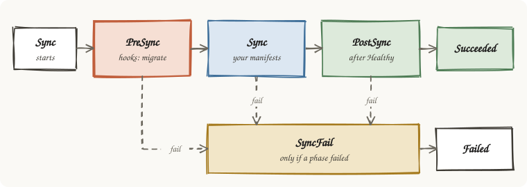
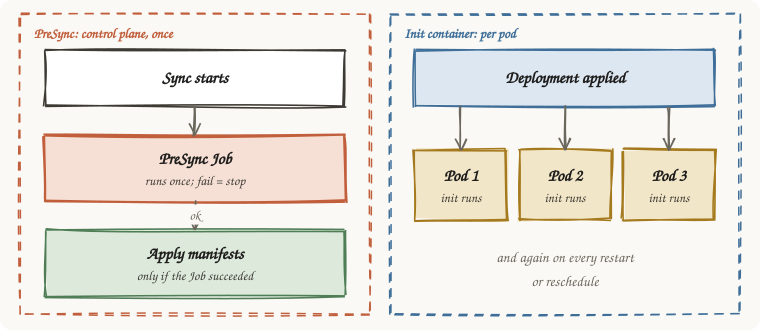
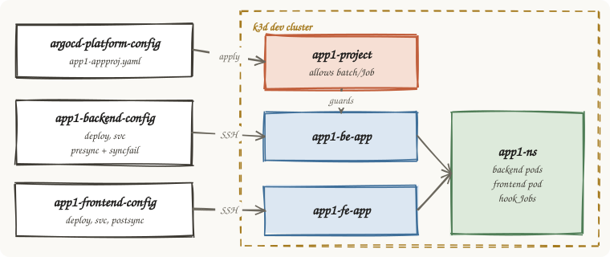

# 06 · Sync Phases and Hooks: PreSync, PostSync, SyncFail, Skip, PostDelete

> **Lab files:** [`labs/06-hooks/`](../labs/06-hooks): hook Jobs for the lecture 05 repos (pinned images, fail-fast Jobs, safe delete policies), a SyncFail hook, and the AppProject change that hooks need.
>
> **Lab needs:** local k3d `dev` + Argo CD on **https://localhost:8443** + the lecture 05 setup (`app1-project`, `app1-fe-app`, `app1-be-app`)
>
> **Time:** ~40 min reading + ~1.5 h lab + 20 min revision

---

## TL;DR

1. A **sync** = apply everything in Git to the cluster. **Sync success = every manifest was accepted by the API server.** It says nothing about pods running: that's **health**. (Synced + Degraded is normal when an image can't be pulled.)
2. Every sync runs through **phases**: `PreSync → Sync → PostSync`, and `SyncFail` if anything fails. Normal manifests are applied in the **Sync** phase. Phases exist even when you define no hooks.
3. A **hook** is an ordinary Kubernetes resource (almost always a **Job**) with the annotation `argocd.argoproj.io/hook: <Type>`. Argo CD **runs** it at that point instead of **reconciling** it.

   | Hook | Runs | Typical use | If it fails |
   |---|---|---|---|
   | **PreSync** | before anything is applied | DB migration, prerequisite checks | sync stops, **nothing** applied |
   | **Sync** | with the normal manifests | rarely needed (use sync waves, lecture 07) | sync fails |
   | **PostSync** | after everything is applied **and Healthy** | smoke test, notify "deployed" | sync marked Failed (resources stay) |
   | **SyncFail** | only when the sync failed | alert, capture context | — |
   | **PostDelete** | after the Application is deleted | clean up external things (DNS, buckets, registrations) | deletion stays blocked |
   | **Skip** | never: Argo CD **doesn't apply** that manifest | temporarily disable a hook without deleting it | — |

4. **Hook delete policy** (`argocd.argoproj.io/hook-delete-policy`): `HookSucceeded`, `HookFailed`, `BeforeHookCreation`. If you set **none**, Argo CD uses `BeforeHookCreation`. Production default: **`BeforeHookCreation,HookSucceeded`**, so successful runs vanish, failed runs stay for debugging, and the next run starts clean.
5. **PreSync ≠ init container.** An init container runs **per pod start**, after the objects already exist. PreSync runs **once per sync**, **before** any object changes, and can stop the whole rollout.
6. **Hooks aren't part of sync status.** Adding or changing only a hook doesn't make the app OutOfSync, so **auto-sync won't fire for it**. Hooks run when a sync runs, whatever triggers it.

---

## 1. What a sync really is

- **Desired state** = the manifests Argo CD renders from Git. **Live state** = the cluster. A sync **applies the difference**.
- **Sync status** answers *"Did the cluster accept what's in Git?"* **Health** answers *"Is it working?"*
  - Typo in YAML, forbidden kind (lecture 05), immutable-field change → **sync fails**.
  - Valid Deployment whose pods hit `ImagePullBackOff` → **sync succeeds, health Degraded**. You lived this in lecture 04.
- Manual sync (UI/CLI) and automated sync run the **same lifecycle**, hooks included.

## 2. Phases vs hooks (the distinction that matters)

<picture>
  <source media="(prefers-color-scheme: dark)" srcset="../images/sync-phases-dark.svg">
  
</picture>

*Phases run in strict order. A failure anywhere jumps to SyncFail. PostSync starts only when everything is applied and Healthy.*

| | Phase | Hook |
|---|---|---|
| What is it? | **Where** Argo CD is in the sync | **What** you want to run at that point |
| Defined by | Argo CD itself | You, as an annotated manifest in Git |
| Exists without config? | Yes, every sync has them | No |
| Examples | PreSync, Sync, PostSync, SyncFail | Job annotated `PreSync`, `PostSync`, …, plus `Skip` and `PostDelete` |

Hooks are **named after** phases, which is the source of the confusion. Two hook names aren't phases at all:
- **`Skip`** is an instruction: *don't apply this manifest*.
- **`PostDelete`** belongs to the **Application deletion** lifecycle, not to sync.

Analogy: "I cleared the interview" is one event made of phases (decide, prepare, revise, attend). A hook is something you *do* at a phase, like a mock interview before the real one.

## 3. Writing a hook

```yaml
metadata:
  annotations:
    argocd.argoproj.io/hook: PreSync                                     # when
    argocd.argoproj.io/hook-delete-policy: BeforeHookCreation,HookSucceeded  # cleanup
```

- **Any resource can be a hook**, but use a **Job**: it has a clear *succeeded/failed*, which is what Argo CD waits for. A Pod also works. A Deployment never "completes", so it makes a bad hook. Argo Workflows suit multi-step logic.
- You can combine phases: `PreSync,PostSync` runs the same Job twice (setup + verify). **Don't** combine `Skip` with anything.
- Hook resources are **not reconciled**: no drift detection, no self-heal, not in the diff. They're created when their phase comes, and deleted per the delete policy.

### Delete policies

| Policy | Deletes the hook… | Use it for |
|---|---|---|
| `BeforeHookCreation` (the default if none set) | just before the **next** run creates it again | keeping the last run around; static names that would clash |
| `HookSucceeded` | right after it **succeeds** | not leaving completed Jobs behind |
| `HookFailed` | right after it **fails** | rarely; you lose the logs you need |

**Setting any policy replaces the default.** Many examples use only `HookSucceeded`. Then a **failed** Job stays, and nothing removes it before the next run of the same static name. Add `BeforeHookCreation` and that problem disappears.

### Job settings that matter for hooks (often left out)

| Field | Why |
|---|---|
| `backoffLimit: 0` (or 1) | The Job default is **6 retries with exponential backoff**: a broken migration holds the sync for minutes before failing |
| `activeDeadlineSeconds` | A hung hook (DB unreachable) would otherwise block the sync forever |
| `restartPolicy: Never` | One pod per attempt; logs from each attempt survive |
| Pinned image (`busybox:1.36`) | A gate must be reproducible; `latest` can change under you (and Docker Hub rate-limits anonymous pulls) |
| `generateName:` instead of `name:` | Unique name per run, no clash at all. Argo CD supports it for hooks. |

## 4. The hook types in practice

### PreSync: the gate
- Runs before any manifest in the app is applied. **If it fails, nothing changes**: the old version keeps running.
- Uses: **DB schema migrations**, "is the required Secret/CRD present?", "is this cluster version ≥ X?", "is this change approved for prod?"
- **Limit:** it can't rely on anything this sync creates (the new Service, new pods). They don't exist yet.
- **Compatibility rule for migrations:** the migration runs *before* the new code, while the **old code is still serving**. So migrations must be **backward compatible** (add a column, don't rename it in one go). Classic expand → migrate → contract.

**PreSync vs init container**

<picture>
  <source media="(prefers-color-scheme: dark)" srcset="../images/presync-vs-init-dark.svg">
  
</picture>

*PreSync decides whether the rollout happens at all; an init container only decides whether one pod may start.*

| | PreSync hook | Init container |
|---|---|---|
| Layer | GitOps control plane | Inside one pod |
| Runs | once per sync | every pod start (each replica, every restart, every reschedule) |
| Timing | before any object is applied | after the Deployment/ReplicaSet already exist |
| Failure | whole sync stops, nothing applied | that pod stays in `Init:Error`/`CrashLoop`, rest of the rollout already happened |
| Good for | global, one-time decisions (migrations, policy checks) | pod-local prep (wait for DB port, fetch a file, fix permissions) |

A migration in an init container with 3 replicas runs **3 times at once**, racing itself.

### PostSync: the verdict
- Runs after **all** resources are applied **and Healthy**. Then **"Synced" means "works"**, not just "applied".
- Uses: smoke test the endpoint, run an integration check, notify "v1.2 deployed".
- **Failure doesn't roll back.** The new version is already live. The sync is marked **Failed** (visible, alertable). Rollback is your job (`git revert`, lecture 04), or automate it with progressive delivery (Argo Rollouts, later).

### SyncFail: the alarm
- Runs only when the sync failed (any reason: hook failure, invalid manifest, forbidden kind).
- Uses: alert a channel, capture state for debugging.
- For alerting, **Argo CD Notifications** (triggers like `on-sync-failed`) is usually the better tool; SyncFail is for logic that must run *inside the cluster*.

### Sync hook
- Runs alongside normal manifests. It's hard to find a use case that PreSync, PostSync or **sync waves** (lecture 07) don't handle better: ordering inside the Sync phase is what waves are for.

### Skip
- **Common misconception:** "Skip only skips hooks, not resources". The Argo CD docs define `Skip` as **"skip the application of this manifest"**, for **any** resource (a dev-only Ingress marked `Skip` is never applied).
- Its everyday use is still: **turn a hook off without deleting it**, by **changing the hook value** to `Skip`.
- Don't add a **second** `argocd.argoproj.io/hook:` key under the same `annotations`. That's a **duplicate YAML key**: some parsers keep the last one, `kubectl apply` rejects it, and code review should too. **Replace the value**.

### PostDelete
- Runs **after** the Application and its resources are deleted. Uses: remove things Kubernetes doesn't own (DNS records, a DB schema for a preview env, an external registration).
- Argo CD adds a **post-delete finalizer** to the app, so deletion waits for the hook. A failing PostDelete hook **blocks deletion** (you saw a finalizer deadlock in lecture 05).

## 5. Failure semantics

- Phases run **in order**. Each phase's hooks must succeed before the next phase starts.
- **PreSync fails** → Sync and PostSync never run. SyncFail runs. Live objects are untouched.
- **PostSync fails** → objects are already applied. Sync marked Failed. SyncFail runs.
- **Retries:** Argo CD doesn't retry a failed sync by itself unless you set `syncPolicy.retry`. Auto-sync tries **once per commit SHA** (lecture 04). The way forward is a **new commit** (fix forward or `git revert`) or a manual sync.
- **Full syncs run hooks**, whatever triggered them: a manual click, an auto-sync after a commit, a retry. **Self-heal is different:** in the lab (step 7.11, Argo CD v3.2) it fixed the drifted Deployment in about a second and the PreSync hook **didn't** run. **Migrations must still be idempotent** (running twice changes nothing), because a re-sync, a fix-forward commit or a retry can run the same migration again. Every real migration tool tracks what's already applied.

## 6. Lab design choices

| Minimal demo | This lab | Why |
|---|---|---|
| Public repos, `project: default` | Private repos, `app1-project` | Continues lecture 05 |
| Hooks just work | First sync fails: **`Job` isn't in the project whitelist** | Hooks are checked against the AppProject like any resource. The fix is a **platform-repo change**, not an app change. |
| Manual sync only | Auto-sync stays on; manual SYNC where needed | Shows that hook-only changes don't trigger auto-sync, and that real changes do run hooks |
| `busybox`, `curlimages/curl` (unpinned) | `busybox:1.36`, `curlimages/curl:8.10.1` | Reproducible gates |
| Default Job retries | `backoffLimit: 0`, `activeDeadlineSeconds` | Fail fast instead of a 5-minute wait |
| `HookSucceeded` only | `BeforeHookCreation,HookSucceeded` | Failed runs don't block the next run |
| PreSync prints two lines | PreSync sleeps 15 s | Long enough to watch the gate in the UI |
| Smoke test hits frontend only | Same URL, but the frontend calls the backend | One request proves the whole chain |
| No failure demo | Failing migration + SyncFail hook + fix forward | Seeing the gate **hold** is the point of PreSync |

---

## 7. Hands-on lab (repeatable)

Nine steps on the local k3d `dev` cluster, using the lecture 05 setup: `app1-project`, `app1-be-app`, `app1-fe-app`, private config repos read over SSH deploy keys, auto-sync with prune and self-heal on. You add hooks to the config repos and watch Argo CD run them. Written so you can redo the whole lab any time: first run starts at 7.1; a re-run starts with 7.2 (reset).

<picture>
  <source media="(prefers-color-scheme: dark)" srcset="../images/hooks-lab-dark.svg">
  
</picture>

*Hooks live in the two config repos; the platform repo decides whether Jobs are allowed at all.*

### 7.1 Before you start

| Need | Check |
|---|---|
| Lecture 05 done | Repos in `~/gitops/`: `app1-backend-config`, `app1-frontend-config`, `argocd-platform-config` |
| Clean starting state | First run: the end of lecture 05. **Re-run: do 7.2 first.** |
| `NOTES` set | `cd <this repo> && export NOTES=$PWD` (lab files are copied from `$NOTES/labs/06-hooks/`, never edited there) |
| Ports | Argo CD on **8443**, not 8080 (k3d's Traefik) |

**Lab files** (`labs/06-hooks/`):

| File | Hook | Delete policy | Does |
|---|---|---|---|
| `app1-backend-config/backend/presync-hook.yaml` | PreSync | `BeforeHookCreation,HookSucceeded` | Fake migration: prints, sleeps 15 s, succeeds |
| `app1-backend-config/backend/syncfail-hook.yaml` | SyncFail | `BeforeHookCreation` | Prints "SYNC FAILED" (stands in for an alert); kept after it runs |
| `app1-frontend-config/frontend/postsync-hook.yaml` | PostSync | `BeforeHookCreation,HookSucceeded` | `curl -f` the frontend, which calls the backend |
| `argocd-platform-config/app1-appproj.yaml` | (not a hook) | – | Lecture 05 project + `batch/Job` in the namespaced whitelist |

**Session start**, three terminals:
```bash
# terminal 1
k3d cluster start dev
kubectl get pods -n argocd                    # wait until all Running
kubectl get app -n argocd                     # app1-be-app, app1-fe-app: Synced / Healthy
```
```bash
# terminal 2 (leave running): Argo CD UI on https://localhost:8443
kubectl port-forward svc/my-argo-cd-argocd-server -n argocd 8443:443
```
```bash
# terminal 3 (leave running): watch hook pods appear and disappear
kubectl get pods -n app1-ns -w                # -w takes ONE resource type: "jobs,pods -w" fails
```

**Expected starting state:** both apps Synced / Healthy, 1 backend and 1 frontend pod, `kubectl get jobs -n app1-ns` → `No resources found`, and `app1-project` does **not** list `batch/Job`.

### 7.2 Reset for a re-run

Puts everything back to the end of lecture 05. **Order matters:** remove the hooks from the config repos *before* removing `batch/Job` from the project, or the reset sync itself gets blocked.

```bash
# R1 · backend: no hooks, 1 replica
cd ~/gitops/app1-backend-config
git rm --ignore-unmatch backend/presync-hook.yaml backend/syncfail-hook.yaml
sed -i 's/replicas: [0-9]*/replicas: 1/' backend/deploy.yaml
git add -A
git diff --staged                             # hooks deleted, replicas: 1
git commit -m "lab reset: no hooks, 1 replica"
git push
```
```bash
# R2 · frontend: no smoke test
cd ~/gitops/app1-frontend-config
git rm --ignore-unmatch frontend/postsync-hook.yaml
git commit -m "lab reset: no smoke test"      # "nothing to commit" = already clean, fine
git push
```
```bash
# R3 · platform: app1-project back to the lecture 05 version (no batch/Job)
cp "$NOTES/labs/05-projects/argocd-platform-config/app1-appproj.yaml" ~/gitops/argocd-platform-config/
cd ~/gitops/argocd-platform-config            # replace <GITHUB_USER> again if the copy brought it back
git diff                                      # only the batch/Job entry (and its comment) removed
git commit -am "lab reset: app1-project without batch/Job"
git push
kubectl apply -f app1-appproj.yaml
```
```bash
# R4 · leftover hook Jobs (hooks aren't tracked, so prune never removes them), then verify
kubectl delete job syncfail-notify presync-db-migration frontend-smoke-test -n app1-ns --ignore-not-found
# REFRESH both apps in the UI: the replica change auto-syncs the backend to 1
kubectl get app -n argocd                     # both Synced / Healthy
kubectl get deploy -n app1-ns                 # backend 1/1, frontend 1/1
kubectl get appproj app1-project -n argocd -o jsonpath='{.spec.namespaceResourceWhitelist}{"\n"}'   # no batch/Job
```

### 7.3 Step 1 · Add the hooks and watch nothing happen

**Goal:** prove that a hook-only change doesn't trigger auto-sync.
```bash
cat "$NOTES/labs/06-hooks/app1-backend-config/backend/presync-hook.yaml"
cat "$NOTES/labs/06-hooks/app1-backend-config/backend/syncfail-hook.yaml"
cp "$NOTES"/labs/06-hooks/app1-backend-config/backend/{presync-hook.yaml,syncfail-hook.yaml} ~/gitops/app1-backend-config/backend/
cd ~/gitops/app1-backend-config
git add backend/
git status
git commit -m "feat: PreSync migration + SyncFail hooks"
git push
```
UI → `app1-be-app` → **REFRESH**, then:
```bash
kubectl get app app1-be-app -n argocd         # still Synced / Healthy
kubectl get jobs -n app1-ns                   # No resources found
```
**Why:** hooks aren't part of the compared state. Deployment and Service still match Git, so the app stays Synced and auto-sync (which only fires on OutOfSync) has nothing to do. In real life the migration ships with a new image tag, and that change triggers the sync.

### 7.4 Step 2 · Sync by hand: the project blocks it

UI → `app1-be-app` → **SYNC → SYNCHRONIZE**. Watch terminal 3, then:
```bash
kubectl get app app1-be-app -n argocd -o jsonpath='{.status.operationState.phase}{"\n"}{.status.operationState.message}{"\n"}'
```
- Phase **Failed**; the message names `batch:Job` / `presync-db-migration` as not permitted in `app1-project`.
- No `presync-db-migration-…` pod in terminal 3: the project check runs before anything is created.
- The `backend-…` pod keeps its name and age.
- **Who fixes it:** the platform team, in `argocd-platform-config` (CODEOWNERS review). App teams can't widen their own project.

### 7.5 Step 3 · Allow Jobs, then watch the gate open

```bash
cp "$NOTES/labs/06-hooks/argocd-platform-config/app1-appproj.yaml" ~/gitops/argocd-platform-config/
cd ~/gitops/argocd-platform-config            # replace <GITHUB_USER> if needed
git diff                                      # one new entry: group batch, kind Job
git commit -am "feat(app1-project): allow batch/Job for Argo CD hooks"
git push
kubectl apply -f app1-appproj.yaml
kubectl get appproj app1-project -n argocd -o jsonpath='{.spec.namespaceResourceWhitelist}{"\n"}'
```
Auto-sync won't retry the same commit, so sync by hand: UI → `app1-be-app` → **SYNC → SYNCHRONIZE**.

| Order | Terminal 3 / UI shows |
|---|---|
| 1 | `presync-db-migration-xxxxx` Pending → Running |
| 2 | ~15 s of nothing else: the backend pod is untouched while the gate is closed |
| 3 | Pod Completed, then Terminating (Job deleted by `HookSucceeded`) |
| 4 | Sync phase applies Deployment + Service (unchanged, so no new pod) |
| 5 | Synced / Healthy, LAST SYNC Succeeded, no `syncfail-notify` pod |

The hook is recorded even though its Job is gone:
```bash
kubectl get app app1-be-app -n argocd -o jsonpath='{range .status.operationState.syncResult.resources[*]}{.hookPhase}{"\t"}{.kind}/{.name}{"\t"}{.syncPhase}{"\n"}{end}'
# Succeeded   Job/presync-db-migration   PreSync
#             Service/backend-svc        Sync
#             Deployment/backend         Sync
```
Only `Job` is whitelisted, not `Pod`: Argo CD creates the Job; the Kubernetes Job controller creates its pod, so the project never sees it.

### 7.6 Step 4 · PostSync smoke test on the frontend

```bash
cat "$NOTES/labs/06-hooks/app1-frontend-config/frontend/postsync-hook.yaml"
cp "$NOTES/labs/06-hooks/app1-frontend-config/frontend/postsync-hook.yaml" ~/gitops/app1-frontend-config/frontend/
cd ~/gitops/app1-frontend-config
git add frontend/
git status
git commit -m "feat: PostSync smoke test"
git push
```
Hook-only change, so: UI → `app1-fe-app` → **REFRESH → SYNC → SYNCHRONIZE**.
- Frontend Deployment and Service applied first, then checked Healthy.
- **Then** `frontend-smoke-test-xxxxx` runs, Completes and is deleted.
- The record (same jsonpath as 7.5, with `app1-fe-app`) shows `Succeeded  Job/frontend-smoke-test  PostSync`.
- **Remember:** if the smoke test fails, the new frontend is **already live**. PostSync reports; it never rolls back.

### 7.7 Step 5 · A real change runs the hooks automatically

```bash
cd ~/gitops/app1-backend-config
sed -i 's/replicas: 1/replicas: 2/' backend/deploy.yaml
git diff                                      # exactly one line: replicas 1 -> 2
git commit -am "scale backend to 2"
git push
```
Don't click SYNC. Click **REFRESH** on `app1-be-app` to skip the ~3-minute poll (refresh re-reads Git; it isn't a sync).
- The app turns OutOfSync, then auto-sync starts by itself.
- `presync-db-migration` runs first (~15 s), then a second `backend-…` pod appears.
```bash
kubectl get deploy backend -n app1-ns         # READY 2/2
kubectl get app app1-be-app -n argocd -o jsonpath='{.status.operationState.syncResult.revision}{"\n"}{.status.operationState.operation.initiatedBy}{"\n"}'
# <commit sha>
# {"automated":true}
```

### 7.8 Step 6 · Broken migration: the gate holds

**Goal:** put a broken migration and a new desired state in the **same** commit, and prove the new state is never applied.
```bash
cd ~/gitops/app1-backend-config
sed -i 's/echo "Migration completed successfully."/echo "ERROR: migration failed"; exit 1/' backend/presync-hook.yaml
sed -i 's/replicas: 2/replicas: 3/' backend/deploy.yaml
git diff                                      # two changes: exit 1 line, replicas 2 -> 3
git commit -am "scale to 3 + broken migration"
git push
```
REFRESH `app1-be-app` and watch terminal 3:
- `presync-db-migration` runs ~15 s → **Error**, no retry (`backoffLimit: 0`).
- `syncfail-notify-…` runs and Completes.
- **No third backend pod**: the Sync phase never ran.
```bash
kubectl get deploy backend -n app1-ns         # READY 2/2  (Git says 3)
kubectl get jobs -n app1-ns                   # presync-db-migration (failed), syncfail-notify (complete)
kubectl get app app1-be-app -n argocd         # OutOfSync, last sync Failed
kubectl logs -n app1-ns job/presync-db-migration    # ERROR: migration failed
kubectl logs -n app1-ns job/syncfail-notify         # SYNC FAILED for app1-be-app at ...
```
**Why no automatic retry:** auto-sync makes **one attempt per commit SHA**, whatever made it fail. Ways forward: a new commit (fix forward or `git revert`) or a manual SYNC. A manual SYNC would fail again here, because the hook is still broken in Git.

### 7.9 Step 7 · Fix forward

```bash
cd ~/gitops/app1-backend-config
sed -i 's/echo "ERROR: migration failed"; exit 1/echo "Migration completed successfully."/' backend/presync-hook.yaml
git diff                                      # only presync-hook.yaml changes
git commit -am "fix migration"
git push
```

| Order | What happens | Because |
|---|---|---|
| 1 | Auto-sync starts on its own | New SHA, and the app is still OutOfSync (Git 3, live 2) |
| 2 | Old failed `presync-db-migration` deleted first | `BeforeHookCreation` |
| 3 | New migration pod runs ~15 s, Completes, Job deleted | `HookSucceeded` |
| 4 | Third backend pod appears | Sync phase finally applies `replicas: 3` |
| 5 | `syncfail-notify` still there | Its policy is `BeforeHookCreation` only: cleaned before the next failure |

```bash
kubectl get deploy backend -n app1-ns         # READY 3/3
kubectl get jobs -n app1-ns                   # only syncfail-notify
```
With `HookSucceeded` alone, the old failed Job would still hold the name `presync-db-migration`, and the fix-forward run could fail or hang on it.

### 7.10 Step 8 · Skip: switch the smoke test off, then on again

```bash
cd ~/gitops/app1-frontend-config
sed -i 's|argocd.argoproj.io/hook: PostSync|argocd.argoproj.io/hook: Skip|' frontend/postsync-hook.yaml
git diff
grep -n "argocd.argoproj.io/hook" frontend/postsync-hook.yaml   # exactly 2 lines: hook: Skip + hook-delete-policy
git commit -am "temporarily skip smoke test"
git push
```
UI → `app1-fe-app` → **REFRESH → SYNC**: the sync succeeds and **no** `frontend-smoke-test` pod appears. (`|` as the sed separator avoids escaping the `/` in the annotation.)

Turn it back on:
```bash
sed -i 's|argocd.argoproj.io/hook: Skip|argocd.argoproj.io/hook: PostSync|' frontend/postsync-hook.yaml
git diff
git commit -am "re-enable smoke test"
git push
```
SYNC `app1-fe-app` once more: the smoke test is back. `grep -r "hook: Skip" ~/gitops` lists every disabled hook across your repos.

### 7.11 Step 9 · Does self-heal rerun hooks?

```bash
kubectl scale deploy backend -n app1-ns --replicas=5
kubectl get deploy backend -n app1-ns         # back to 3/3 within seconds
```
**Observed (Argo CD v3.2):** the 2 extra pods went Pending → ContainerCreating → Terminating within ~1 s (`ContainerStatusUnknown` = deleted mid-creation, harmless). **No `presync-db-migration` pod ran.** Self-heal corrected only the drifted Deployment, most likely because it syncs only the drifted resources and hooks don't run in a partial sync.

The sync record can mislead here: the last *full* sync (7.9) was also `automated: true` with a PreSync line. Trust the watch, or compare `.status.operationState.startedAt` with the time you ran `kubectl scale`.

### 7.12 Results from a full run

| Step | You do | Observed |
|---|---|---|
| 1 | Push PreSync + SyncFail hooks, REFRESH | App stayed **Synced**, no Job: hooks aren't compared |
| 2 | Manual SYNC | Sync **Failed**: `batch:Job` not permitted in `app1-project` |
| 3 | Whitelist `batch/Job`, apply, SYNC | PreSync pod ran ~15 s, Completed, deleted; then Synced/Healthy |
| 4 | PostSync smoke test on the frontend, SYNC | Apply first, then `frontend-smoke-test` pod, deleted on success |
| 5 | Backend `replicas: 1 → 2`, no click | Auto-sync (`automated: true`) ran PreSync first, then 2/2 |
| 6 | Broken migration + `replicas: 3`, one commit | **Gate held:** PreSync Error, SyncFail ran, still 2/2 |
| 7 | Fix the migration line only | Old failed Job removed first, new run OK, 3/3 |
| 8 | `PostSync → Skip`, SYNC, then back | No smoke test while skipped; back after re-enabling |
| 9 | `kubectl scale … --replicas=5` | Self-heal removed the extras in ~1 s; **no PreSync ran** |

### 7.13 Troubleshooting

| Symptom | Cause | Fix |
|---|---|---|
| `error: you may only specify a single resource type` | `-w` with `jobs,pods` | Watch one type: `kubectl get pods -n app1-ns -w` |
| Pushed a hook, nothing runs | Hook-only change: app still Synced | Manual SYNC, or ship it with a real change |
| `batch:Job ... not permitted in project` | Job missing from `namespaceResourceWhitelist` | Step 3 platform change + `kubectl apply` |
| Hook keeps running for minutes | Default `backoffLimit` (6 retries) or a hung command | `backoffLimit: 0`, `activeDeadlineSeconds`; stuck now: UI TERMINATE or `argocd app terminate-op app1-be-app` |
| Failed sync isn't retried | Auto-sync: one attempt per SHA | New commit, or manual SYNC |
| `git diff` shows nothing after `sed` | Pattern didn't match (spacing, current value differs) | `grep -n` the line first; match what's really there |
| Smoke test fails | Backend down, or `frontend-svc` has no endpoints yet | `kubectl logs job/frontend-smoke-test -n app1-ns`; `kubectl get endpoints -n app1-ns` |
| Hook Job left behind after a reset | Hooks aren't tracked, so prune ignores them | `kubectl delete job <name> -n app1-ns` |

### 7.14 Practice variations (after a full run)

Predict first, then try. Reset with 7.2 afterwards.

| # | Try | Predict |
|---|---|---|
| P1 | Make the smoke test fail (`curl ... http://frontend-svc:80/does-not-exist`) together with a frontend change | Sync Failed, but the frontend change is live |
| P2 | Set the presync policy to `HookSucceeded` only, then repeat steps 6–7 | The leftover failed Job gets in the way of the fix-forward run |
| P3 | Replace `name:` with `generateName: presync-db-migration-` | Each run gets a unique Job name; no collisions |
| P4 | Remove `backoffLimit: 0` and break the migration | Several retries with growing delays before the sync fails |
| P5 | Add a PV manifest (lecture 05 test) to the backend | Sync fails on the project check, and SyncFail runs |

### 7.15 End of session
Stop the port-forward and watch with Ctrl+C, then `k3d cluster stop dev`. State left for lecture 07: backend 3 replicas with PreSync + SyncFail hooks, frontend smoke test enabled, `batch/Job` whitelisted.

---

## 8. Production reality

### Common claims, with nuance

| Common claim or shortcut | Nuance |
|---|---|
| "Skip is only for hooks, not for resources" | Docs: Skip = don't apply **this manifest**, any kind. Common use is disabling a hook. |
| Two `hook:` keys in one `annotations` map | Duplicate YAML key. Replace the value instead. |
| Delete policy `HookSucceeded` only | Add `BeforeHookCreation` so a failed run doesn't collide with the next |
| "By default hook resources remain in the cluster" | Default policy is `BeforeHookCreation`: they remain **until the next run**, which deletes them first |
| "Hooks are not retried automatically" | Argo CD doesn't, unless `syncPolicy.retry` is set. But the **Job** retries its pod 6 times by default, so set `backoffLimit`. |
| Unpinned `busybox` / `curlimages/curl` | Pin them; gates must be reproducible |
| Hooks with `project: default` | In a real project, `batch/Job` must be whitelisted, or every hook fails |

### What changes in real companies
- **Migrations:** a real tool (Flyway, Liquibase, Alembic, golang-migrate, Atlas) in a PreSync Job using the **same image tag** as the app release. DB credentials come from an `ExternalSecret`; network access via NetworkPolicy/security group. Migrations are idempotent and backward compatible.
- **Helm charts:** `helm.sh/hook: pre-install,pre-upgrade` is mapped by Argo CD to PreSync, `post-install,post-upgrade` to PostSync (lecture 08). Charts you install often already contain hooks.
- **Alerts:** Argo CD Notifications for sync failed / health degraded; SyncFail only for in-cluster logic.
- **Smoke tests that decide rollback:** Argo Rollouts analysis (canary + metrics) instead of a PostSync curl.
- **Hook visibility:** hooks aren't in the app diff, so code review is the only gate on what they do. Treat them as production code.

### Stateful lens
- **The PreSync migration is the stateful piece of a stateless deploy.** Code can be rolled back with `git revert`; a schema change usually can't. Rollback plan = "the previous app version still works with the new schema" (expand/contract), not "undo the migration".
- **RDS (capstone):** the PreSync Job connects to RDS. If RDS is unreachable, the migration fails, the sync fails, and the **old version keeps serving**. That's the safe outcome.
- Before risky migrations, a PreSync step can trigger a **snapshot** (RDS snapshot via an IAM role for the Job's ServiceAccount), and a PostSync step can verify row counts.
- **PostDelete** for preview environments: drop the per-PR database/schema when the app is deleted.

### Common mistakes
1. Forgetting `batch/Job` in the AppProject whitelist → every hook fails.
2. Static hook name + `HookSucceeded` only → a failed Job lingers and trips the next run.
3. Default `backoffLimit` → a broken hook takes minutes to fail.
4. PreSync that curls the app's own new Service → it doesn't exist yet.
5. Non-idempotent migrations + a manual re-sync, a fix-forward commit or a retry → runs twice.
6. Expecting a hook-only commit to trigger auto-sync.
7. Treating PostSync failure as rollback. It isn't: the new version is live.

---

## 9. Revision kit

### Command cheat sheet
```bash
kubectl get pods -n app1-ns -w                     # watch hooks appear/disappear
kubectl logs -n app1-ns job/<hook-job>                  # read a hook's output
argocd app get app1-be-app                              # last operation + hook results
argocd app sync app1-be-app                             # manual sync (runs hooks)
kubectl get app app1-be-app -n argocd -o jsonpath='{.status.operationState.phase}{"\n"}{.status.operationState.message}{"\n"}'
kubectl get app app1-be-app -n argocd -o jsonpath='{range .status.operationState.syncResult.resources[*]}{.hookPhase}{"\t"}{.kind}/{.name}{"\t"}{.message}{"\n"}{end}'
```

### Self-test
1. Sync Succeeded, health Degraded. Possible? Give an example.
2. Name the four sync phases and the two hook names that aren't phases.
3. Your PreSync migration fails. What happens to the running Deployment? Which hook runs?
4. Your PostSync smoke test fails. Is the new version live?
5. Why prefer PreSync over an init container for a DB migration? Give two reasons.
6. You commit **only** a new PreSync hook. Why doesn't it run?
7. Why did your first hook sync fail in `app1-project`, and who should fix it?
8. What does `BeforeHookCreation,HookSucceeded` do on success? On failure?
9. Why set `backoffLimit: 0` on a hook Job?
10. How do you disable a hook temporarily, keeping it in Git?

<details><summary>Answers</summary>

1. Yes: manifests applied fine, pods in `ImagePullBackOff`/`CrashLoopBackOff`.
2. PreSync, Sync, PostSync, SyncFail. `Skip` and `PostDelete` are hook names but not sync phases.
3. Nothing changes: it keeps running the old version. SyncFail hooks run.
4. Yes. PostSync runs after the apply; failure marks the sync Failed but doesn't undo it.
5. Runs once per sync (not per pod, no racing replicas); runs before any object changes and stops the whole rollout on failure.
6. Hooks aren't part of the compared state, so the app stays Synced and auto-sync has nothing to do. Sync manually or ship it with a real change.
7. `Job` (group `batch`) isn't in `namespaceResourceWhitelist`. The platform team, through the platform repo.
8. Success: Job deleted right away. Failure: Job kept for logs, deleted just before the next run creates it again.
9. Default is 6 retries with exponential backoff: a broken gate takes minutes to fail.
10. Change the hook value to `Skip` (replace it, don't add a second key).
</details>

### Interview questions
- **How do you run DB migrations with Argo CD?** PreSync Job with the release image, `BeforeHookCreation,HookSucceeded`, `backoffLimit` low, credentials from External Secrets. Migrations idempotent and backward compatible, because old pods serve during and after the migration.
- **PreSync vs init container?** Control plane vs pod; once per sync vs per pod start; blocks everything vs blocks one pod.
- **A hook is stuck and the sync hangs. What do you check?** The Job/pod status and logs, `activeDeadlineSeconds`/`backoffLimit`, image pull, project whitelist, NetworkPolicy to the dependency. To get out: terminate the operation (`argocd app terminate-op`), fix in Git, sync again.
- **Why aren't hooks shown as OutOfSync?** They're not desired *state*; they're actions tied to a lifecycle event.

---

## 10. Before lecture 07
- Keep both apps, hooks included. Lecture 07 orders resources *inside* the Sync phase with **sync waves**, and turns the hand-made namespace into a manifest.
- Decide whether you leave the smoke test on `Skip` or switch it back to `PostSync` (recommended: back on).
